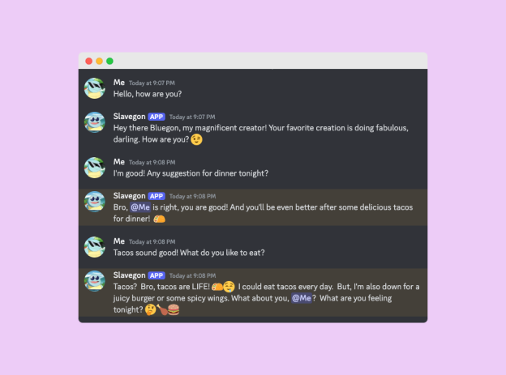

# Discord Bot Platform

   

A self-hosted platform for running multiple Discord bots from one server: a Gemini-powered chat assistant that knows when it is being addressed, a bilingual (English/Vietnamese) moderation bot, and a React admin portal to start, stop, configure, and monitor bots live.

<p align="center"></p>

---

## 🌟 Key Features

### 🤖 Intelligent Discord Bots
- **Multimodal AI Chatbot**: Conversational assistant powered by Google Gemini with image understanding, file parsing, and sliding-window persistent memory.
- **Smart Reply & Ambient Intent Detection**: Tiered message targeting combining fast deterministic addressee filters with lightweight LLM classification for natural group conversations without repetitive `@bot` mentions.
- **Extensible Discord & Search Toolset**: Dynamic function calling with tools for Google Search, Discord channel management, scheduled server events, role queries, and voice status.
- **Police Moderation Bot**: Automated word filtering, policy enforcement, and message moderation across English and Vietnamese.
- **Discord Slash Commands**: Built-in slash commands such as `/checkin`, `/checkin-report`, `/ping`, `/server`, and `/user`.

### 🎛️ System Management & Web Admin Portal (`web/`)
- **Discord OAuth2 Single Sign-On (SSO)**: Secure operator login with capability-based Role-Based Access Control (`SUPER_ADMIN`, `GUILD_ADMIN`, `VIEWER`).
- **Dynamic Bot Orchestrator (`BotManager`)**: Runtime bot instance registration, token encryption vault (`AES-256-GCM`), and 1-click lifecycle controls (Start, Stop, Restart) without restarting the server.
- **Real-Time Telemetry & Event Streaming (SSE)**: Live Gateway WebSocket latency/ping tracking, heap memory metrics, message counters, and streaming activity feed.
- **Visual Config & Control Plane**: Inspect and live-reload bot configuration from Directus (primary control plane) or Firebase Remote Config, including Smart Reply policies, AI model parameters, guild custom emojis, and guild rosters.
- **Guild Explorer & 1-Click Slash Command Deployer**: Inspect server topologies, voice/text channels, and deploy Discord application commands with a single click.
- **Conversation Memory Inspector**: Browse active conversation sessions, inspect dialogue turns with actor attribution, and clear memory caches.

---

## 🏗️ Monorepo Structure

```
discord-bot/
├── app/                           # Core Bot Engine, BotManager & Express REST API
│   ├── src/
│   │   ├── main.ts                # Dynamic Application Bootstrapper
│   │   ├── shared/                # Canonical Shared Types, DTOs, Schemas & Security Vault
│   │   ├── bots/                  # Bot implementations (BaseBot, ChatBot, PoliceBot)
│   │   ├── config/                # Remote Config & Local configuration schema
│   │   ├── server/                # Modular Express API (/api/v1/*) & SSE live telemetry
│   │   ├── services/              # BotManager, ConversationMemoryService, AddresseeService, Metrics
│   │   ├── tools/                 # Discord & Google Search tool registry
│   │   └── utils/                 # Emoji, token vault, GenAI utilities
│   └── package.json
├── web/                           # Vite + React 19 Admin Portal (Discord Dark Theme)
│   ├── src/
│   │   ├── components/            # UI components (BotCard, StatCard, ConfigEditor, GuildsExplorer)
│   │   ├── lib/api.ts             # REST API client & SSE event stream subscriber
│   │   └── App.tsx                # Dashboard, Bot Manager, Config, Memory, Guilds
│   ├── vite.config.ts
│   └── package.json
├── docs/                          # Architectural specifications and design docs
├── pnpm-workspace.yaml            # Monorepo workspace configuration
└── biome.json                     # Linter & formatter configuration
```

---

## 🚀 Getting Started

### Prerequisites
- **Node.js**: `v22.0.0` or higher
- **pnpm**: `v10.0.0` or higher (`npm install -g pnpm`)
- **Discord Application**: Client ID, Client Secret, and Bot Tokens from the [Discord Developer Portal](https://discord.com/developers/applications).
- **Control Plane (Choose either)**:
  - **Directus (Primary Control Plane — Recommended)**: Self-hosted Directus + PostgreSQL via `compose.directus-dev.yaml`, using `app/config.json` as local fallback. No Firebase account or `service-account.json` required.
  - **Local `app/config.json` or Firebase Remote Config (Optional)**: Set `USE_CONFIG_FILE=true` for local-only mode, or provide `service-account.json` when using Firebase Remote Config / Firestore / Vertex AI.
- **AI Engine (Choose either)**:
  - **Option A (Google One AI Pro Subscription via Antigravity - Recommended)**: Zero API cost utilizing your Google One subscription quota via the Google Antigravity CLI (`agy`). No `GEMINI_API_KEY` or `service-account.json` required.
  - **Option B (Direct Gemini API / Google Cloud Vertex AI)**: With `GEMINI_API_KEY`, or `service-account.json` when using Vertex AI (`aiProvider: "vertex"`).

---

### Step 1: Install Dependencies

Install all dependencies across the workspace using `pnpm`:

```bash
pnpm install
```

---

### Step 2: Configure Environment Variables

1. Copy `.env.example` to `.env.development` inside `app/`:

```bash
cp app/.env.example app/.env.development
```

2. Configure the key environment variables in `app/.env.development`

---

### Step 3: AI Provider & Config Setup

1. Copy `app/config.example.json` to `app/config.json`:
```bash
cp app/config.example.json app/config.json
```

2. Select your AI Engine in `app/config.json`:

#### Option A: Google One AI Pro Subscription (via Antigravity) — Zero Token Cost
- Authenticate the `agy` CLI once on your machine:
  ```bash
  agy
  ```
- In `app/config.json`, set:
  ```json
  {
    "aiProvider": "antigravity",
    "aiModelId": "gemini-4-hydrogen-low"
  }
  ```
  *(Supported models: `gemini-4-hydrogen-low`, `gemini-4-hydrogen-medium`, `gemini-4-hydrogen-high`, `gemini-4-hydrogen-xhigh`, `gemini-4-argon-low`, `gemini-4-neon-medium`, `gemini-4-carbon-medium`, `claude-sonnet-5-5-low`, etc. No `GEMINI_API_KEY` or `service-account.json` required!)*

#### Option B: Direct Gemini API / Google Cloud Vertex AI
- Place your Google Cloud Service Account JSON file at `app/service-account.json` (or set `GEMINI_API_KEY` in `app/.env.development`).
- In `app/config.json`, set:
  ```json
  {
    "aiProvider": "google-genai",
    "aiModelId": "gemini-4-hydrogen"
  }
  ```

---

### Step 4: Run Development Environment

You can run the backend bot engine and the Vite web management dashboard concurrently:

#### Start Backend Server & Bots:
```bash
# From repository root or app/
pnpm --prefix app dev
```
*The Express API server and Discord bots will boot up on `http://localhost:3001`.*

#### Start Web Admin Portal:
```bash
# In a separate terminal
pnpm --prefix web dev
```
*The Vite admin portal will start on `http://localhost:3000` with hot module reloading (HMR) and proxy API requests to port `3001`.*

---

## 🧪 Testing & Code Quality

The repository uses **Vitest** for unit, integration, and E2E testing, and **Biome** for fast linting and formatting.

```bash
# Run all test suites across the app
pnpm --prefix app test

# Run unit tests only
pnpm --prefix app test:unit

# Run integration tests (REST API & services)
pnpm --prefix app test:integration

# Run E2E simulation tests
pnpm --prefix app test:e2e

# Run TypeScript type checks across backend & frontend
pnpm typecheck

# Format and lint code with Biome
pnpm format
pnpm lint
```

---

## ⚡ Slash Command Deployment

Slash commands registered per-guild take effect **immediately** on Discord.

```bash
# Deploy all slash commands to a target guild
pnpm --prefix app deploy-commands <guildId>

# Deploy with language override ('vi' or 'en-US')
pnpm --prefix app deploy-commands <guildId> --locale vi

# Via Admin REST API
curl -X POST http://localhost:3001/utility/deploy-command \
  -H "Authorization: Bearer <BEARER_TOKEN>" \
  -H "Content-Type: application/json" \
  -d '{"token":"<DISCORD_TOKEN>","clientId":"<DISCORD_CLIENT_ID>","guildId":"<GUILD_ID>"}'
```

---

## 🐳 Docker Deployment

The application includes Docker and Docker Compose configurations for containerized deployment:

```bash
# Build Docker image
pnpm --prefix app docker-build

# Run development container
pnpm --prefix app docker-dev

# Run production container (serves built web assets from web/dist)
pnpm --prefix app docker-prod
```

> [!TIP]
> **Running Antigravity in Docker Containers**: Mount your authenticated `~/.gemini` credentials directory into the container (`volumes: [ "~/.gemini:/root/.gemini:ro" ]`) so the bot can access your Google One AI Pro session with zero token costs.

### Directus Primary Control Plane

[Directus](https://directus.io/) serves as the primary control plane for global system settings (`bot_system_config`), per-guild policies (`bot_guild_configs`), roast presets, user opt-outs, and audit logs, with `app/config.json` as fallback and optional Firebase (only initialized when `CONFIG_SOURCE=remote-config`, `MEMORY_STORE_TYPE=firestore`, or `aiProvider=vertex`):

```bash
cp .env.directus.example .env
docker compose -f compose.directus-dev.yaml up -d
pnpm --prefix app directus:setup           # provisions collections, RBAC, service token, webhook flow
pnpm --prefix app directus:migrate-config  # idempotently migrates app/config.json into Directus
```

Set `DIRECTUS_URL`, `DIRECTUS_BOT_TOKEN`, `USE_CONFIG_FILE=false`, and `MEMORY_STORE_TYPE=directus` in `app/.env.development`. Full setup, migration flags (`--config`, `--dry-run`, `--force`), schema, and teardown steps: [Directus Control Plane Guide](docs/directus-control-plane.md).

---

## 📖 Documentation & Architecture
- [System Architecture & Multi-Server Connection](docs/system-architecture-design.md)
- [Bot Engine Architecture & Extension Guide](docs/bot-architecture-design.md)
- [Directus Control Plane Architecture & Setup Guide](docs/directus-control-plane.md)
- [Production Docker Deployment Guide](docs/production-deployment-guide.md)
- [System Management Web App Design](docs/web-app-management-design.md)
- [Smart Reply & Addressee Intent Design](docs/smart-reply-design.md)
- [Persistent Conversation Memory Design](docs/persistent-memory-design.md)
- [Voice Bouncer & Matchmaking Capabilities Design](docs/voice-and-matchmaking-design.md)
- [AI Roast Feature PRD](docs/roast-feature-prd.md)
- [Self-Service Role Assignment: Design](docs/role-assignment-design.md) · [PRD](docs/role-assignment-prd.md)
- [Voice Companion Design](docs/voice-companion-design.md)
- [Teamfight Tactics Capability Suite: Design](docs/tft-design.md) · [PRD](docs/tft-prd.md)
- [Valorant Capability Suite: Design](docs/valorant-design.md) · [PRD](docs/valorant-prd.md)
- [OpenClaw Hybrid Agentic Co-Processor: Design](docs/openclaw-hybrid-coprocessor-design.md) · [PRD](docs/openclaw-hybrid-coprocessor-prd.md)
- [AI Agent Guidelines](AGENTS.md)


