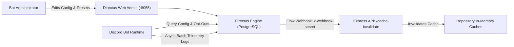

# Directus Control Plane Architecture & Setup Guide

## 1. Overview & Architectural Role

[Directus](https://directus.io/) acts as the **Headless CMS and Operational Control Plane** for the Discord Bot ecosystem. It provides non-technical server operators and bot administrators with a clean visual UI to configure guild rules, AI prompts, user privacy preferences, and audit telemetry in real time without code deployment.

### Key Capabilities
- **Dynamic Guild Configuration**: Per-guild feature toggles, default locales, allowed channel lists, voice channel IDs, and rate limits.
- **AI Roast Persona Presets**: Centralized repository of system prompt guidelines, temperature overrides, and banned safety terms.
- **User Privacy & Opt-Out Records**: Guild-scoped and global opt-out registries for user privacy protection.
- **Audit Logs & Telemetry**: Asynchronous buffered logging of roast generations, response times, feedback scores, and match logs.
- **Zero-Downtime Cache Invalidation**: Automatic webhook signals from Directus Flow/Event hooks to the bot's Express API (`/api/v1/webhooks/cache-invalidate`) to invalidate in-memory caches upon database edits.



---

## 2. Environment Variables Matrix

The system separates environment variables between the containerized Docker Compose stack and the Node.js Discord bot application.

### Docker Compose Stack (`compose.directus-dev.yaml`)
Defined in `.env.directus.example` (copied to `.env` at the repository root):

| Variable | Default Value | Description |
| :--- | :--- | :--- |
| `POSTGRES_USER` | `directus` | PostgreSQL database username |
| `POSTGRES_PASSWORD` | `directus_dev_password` | PostgreSQL database user password |
| `POSTGRES_DB` | `directus` | PostgreSQL database name |
| `POSTGRES_PORT` | `5433` | Host port mapped to PostgreSQL container (`5432`) |
| `DIRECTUS_PORT` | `8055` | Host port mapped to Directus Web Admin and REST API |
| `DIRECTUS_KEY` | `local-dev-directus-secret-key-32chars` | 32+ char secret key used for session/cookie generation |
| `DIRECTUS_SECRET` | `local-dev-directus-secret-token-32` | 32+ char secret token used for Directus encryption |
| `DIRECTUS_PUBLIC_URL` | `http://localhost:8055` | Publicly accessible URL of the Directus instance |
| `DIRECTUS_ADMIN_EMAIL` | `admin@local.dev` | Initial admin email created upon first container boot |
| `DIRECTUS_ADMIN_PASSWORD` | `adminpassword` | Initial admin password created upon first container boot |

### Discord Bot Engine (`app/.env.development`)
Configured in `app/.env.development` (template from `app/.env.example`):

| Variable | Required | Default Value | Description |
| :--- | :---: | :--- | :--- |
| `DIRECTUS_URL` | No | `http://localhost:8055` | Base endpoint of Directus REST API |
| `DIRECTUS_BOT_TOKEN` | Yes* | *(none)* | Static service token assigned to the `bot-service` user |
| `MEMORY_STORE_TYPE` | No | `local` | Set to `directus` to activate Directus for user opt-out persistence |
| `INTERNAL_WEBHOOK_SECRET` | No | *(none)* | Shared secret for timing-safe authentication on cache invalidation webhook |
| `WEBHOOK_RECEIVER_URL` | No | `http://localhost:3001/api/v1/webhooks/cache-invalidate` | Callback URL registered in Directus for cache evictions |
| `DIRECTUS_ADMIN_EMAIL` | No | `admin@local.dev` | Admin email used exclusively by `pnpm --prefix app directus:setup` |
| `DIRECTUS_ADMIN_PASSWORD` | No | `adminpassword` | Admin password used exclusively by `pnpm --prefix app directus:setup` |

*\* Required when `MEMORY_STORE_TYPE=directus` or when executing `pnpm --prefix app directus:setup`.*

---

## 3. Collections Schema Reference

The Directus database schema is managed via `app/directus/schema.yaml` and provisioned automatically with `pnpm --prefix app directus:setup`:

### `bot_guild_configs`
Configures guild-level runtime behaviors and feature policies.
- `id` (UUID, PK)
- `guild_id` (String, Unique, Required): Target Discord Guild Snowflake.
- `guild_name` (String, Optional): Human-readable guild name for auditing.
- `enable_ai_roast` (Boolean, Default: `true`): Whether the AI Roast capability is active in this server.
- `enable_bouncergon` (Boolean, Default: `false`): Voice bouncer and matchmaking feature toggle.
- `default_locale` (String, Default: `"vi"`): Default language for bot responses (`"vi"` or `"en"`).
- `max_roasts_per_day` (Integer, Default: `10`): Rate limit per guild per calendar day.
- `allowed_channel_ids` (JSON Array of strings): Channel Snowflakes where the feature is permitted.
- `scms_voice_channel_id` (String, Optional): Default voice channel for matchmaking events.

### `bot_roast_presets`
Stores AI prompt templates and generation hyper-parameters.
- `id` (UUID, PK)
- `preset_name` (String, Unique, Required): Identifier for prompt preset (e.g., `"default"`).
- `system_prompt` (Text, Required): Custom instructions provided to Google Gemini.
- `temperature` (Float, Default: `0.8`): Sampling temperature for roast generations.
- `is_active` (Boolean, Default: `true`): Toggle preset availability.
- `banned_terms` (JSON Array of strings): Terms rejected or sanitized during prompt building.

### `bot_user_profiles`
Maintains user preferences and privacy settings.
- `id` (UUID, PK)
- `user_id` (String, Unique, Required): Discord User Snowflake.
- `opt_out_roast` (Boolean, Default: `false`): Global opt-out flag from roasts.
- `opted_out_guild_ids` (JSON Array of strings): Guild-specific opt-out Snowflakes.
- `reputation_score` (Integer, Default: `1000`): Internal community standing score.

### `bot_roast_logs`
Audit log and telemetry records (buffered in memory and drained periodically).
- `id` (UUID, PK)
- `guild_id` (String), `channel_id` (String), `caller_user_id` (String), `target_user_id` (String)
- `topic` (String), `generated_text` (Text)
- `execution_time_ms` (Integer), `feedback_rating` (Integer, Optional)

### `bot_match_logs`
Historical match sessions created by the voice matchmaking service.
- `id` (UUID, PK)
- `guild_id` (String)
- `team_a_roster` (JSON Array), `team_b_roster` (JSON Array)
- `score_team_a` (Integer), `score_team_b` (Integer), `winner` (String), `mvp_user_id` (String)

---

## 4. Cache Invalidation & Webhook Protocol

To minimize latency and avoid exhausting rate limits on Directus, all repositories cache reads locally in memory with TTL fallbacks. When changes occur in Directus:

1. A Directus Webhook is registered by `setupDirectus.ts` watching `bot_guild_configs` and `bot_roast_presets` for `create`, `update`, and `delete` events.
2. Directus dispatches a `POST` request to `WEBHOOK_RECEIVER_URL` with the `x-webhook-secret` header.
3. The Express route handler (`/api/v1/webhooks/cache-invalidate`) validates the secret using timing-safe buffer comparison (`crypto.timingSafeEqual`).
4. The corresponding repository evicts cached keys immediately, ensuring subsequent Discord operations load the newest settings.

---

## 5. Local Setup Walkthrough

### Step 1: Prepare Environment Files
1. Copy the Docker Compose template:
   ```bash
   cp .env.directus.example .env
   ```
2. Configure Directus credentials in `app/.env.development`:
   ```bash
   DIRECTUS_BOT_TOKEN=my-secure-directus-bot-token
   INTERNAL_WEBHOOK_SECRET=my-local-webhook-secret
   ```

### Step 2: Start Containers
```bash
docker compose -f compose.directus-dev.yaml up -d
```
Verify container health:
```bash
docker compose -f compose.directus-dev.yaml ps
```
Ensure `discord-bot-postgres-dev` displays `(healthy)`.

### Step 3: Bootstrap Schema & Service User
Run the setup script from the workspace root:
```bash
pnpm --prefix app directus:setup
```
This script will:
- Authenticate with Directus using admin credentials.
- Ensure all 5 core collections exist with correct field schemas.
- Create the `bot-service-policy` and grant permissions.
- Create the `bot-service` role and assign permissions.
- Create or update the `bot-service` user with `DIRECTUS_BOT_TOKEN`.
- Seed default roast presets.
- Provision the cache invalidation webhook.

### Step 4: Enable Directus in the Bot
In `app/.env.development`, set:
```bash
MEMORY_STORE_TYPE=directus
```

### Step 5: Verify via Admin UI
Open `http://localhost:8055`:
- Sign in with `admin@local.dev` / `adminpassword`.
- Inspect the collections in the Content module.

---

## 6. Teardown & Troubleshooting

### Stopping Containers
```bash
docker compose -f compose.directus-dev.yaml down
```

### Full Reset (Wipe Database & Upload Volumes)
```bash
docker compose -f compose.directus-dev.yaml down -v
```

### Common Issues & Solutions

| Symptom | Cause | Solution |
| :--- | :--- | :--- |
| `Missing required environment variable: DIRECTUS_BOT_TOKEN` | `DIRECTUS_BOT_TOKEN` not configured in `app/.env.development` | Set `DIRECTUS_BOT_TOKEN` to a non-empty string in `app/.env.development`. |
| Port `5432` or `5433` already in use | Conflicting local PostgreSQL instance | Change `POSTGRES_PORT` in `.env` to another open port (e.g., `5434`). |
| Connection refused to `http://localhost:8055` | Containers still initializing | Check `docker compose -f compose.directus-dev.yaml logs -f directus-dev` and wait for Directus to complete migrations. |
| Cache invalidation webhook returns `401 Unauthorized` | Mismatched `INTERNAL_WEBHOOK_SECRET` | Verify `INTERNAL_WEBHOOK_SECRET` matches between `app/.env.development` and Directus Webhook headers. |
