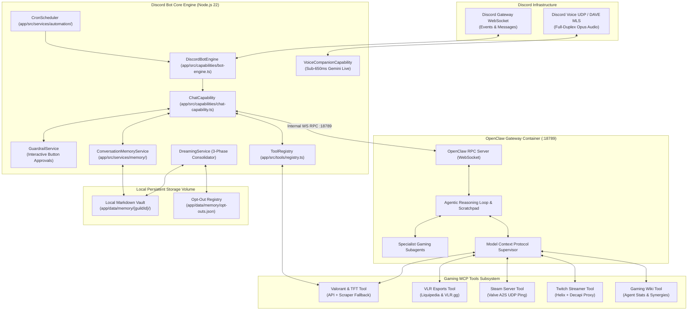
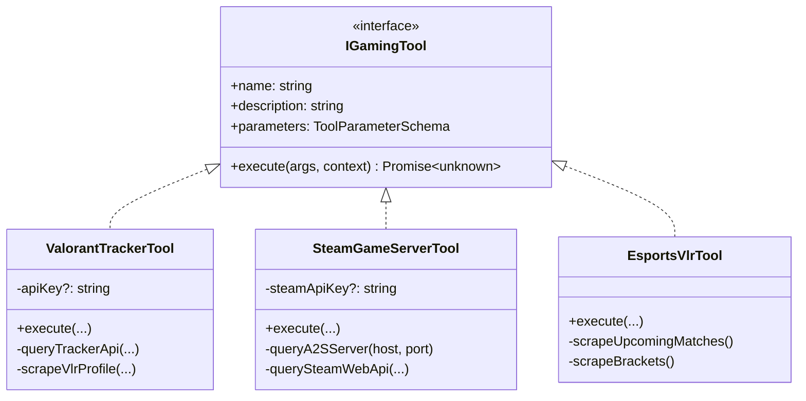
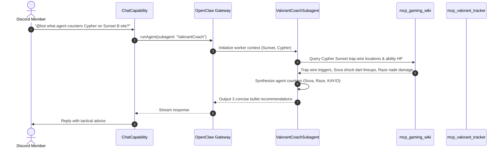
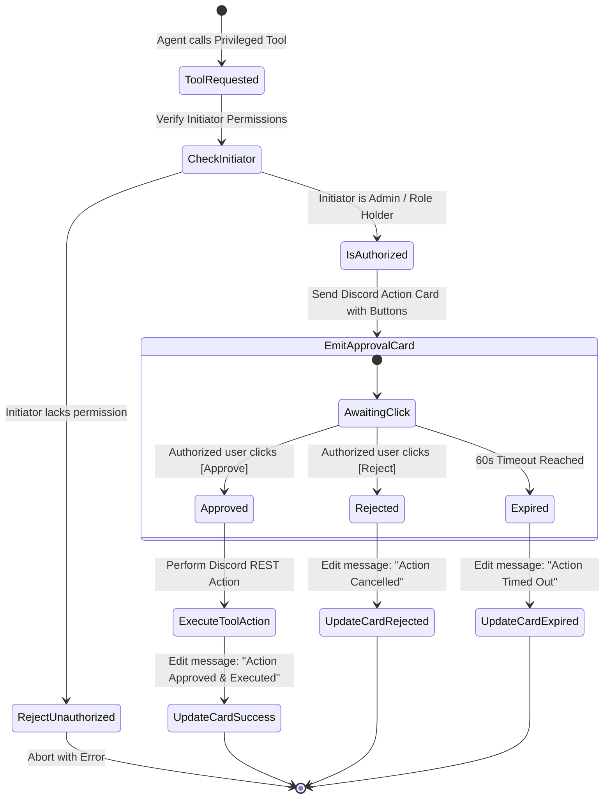

# Technical Design Document: OpenClaw Hybrid Agentic Co-Processor

**Author**: Antigravity & Hung Nguyen  
**Status**: Proposed / Design Specification  
**Target Platform**: `discord-bot` (Node.js 22, TypeScript 5, Discord.js v14, OpenClaw Gateway, Directus 12 / Docker)  
**Document Stage**: Stage 2 (TDD)  
**PRD Reference**: [`docs/openclaw-hybrid-coprocessor-prd.md`](./openclaw-hybrid-coprocessor-prd.md)  
**Date**: 2026-10-17  

---

## 1. System Architecture & Component Interaction

The **OpenClaw Hybrid Agentic Co-Processor** runs as a companion service inside a co-located Docker Compose stack. The Discord bot maintains its native Discord.js gateway connection, low-latency audio pipeline, and Directus data store, while delegating complex reasoning, gaming MCP queries, and subagent tasks to the **OpenClaw Gateway** over an authenticated internal WebSocket RPC bridge:



---

## 2. Docker Co-Location & Infrastructure (`compose.prod.yaml`)

Both services share the private internal Docker network `bot-network`. The OpenClaw Gateway port (`18789`) is bound only to `127.0.0.1` for local administration and communicated internally via the Docker DNS service name `openclaw-gateway`:

```yaml
services:
  discord-bot:
    build:
      context: ./app
      dockerfile: Dockerfile
    container_name: discord-bot-engine
    restart: unless-stopped
    depends_on:
      openclaw-gateway:
        condition: service_started
    environment:
      - NODE_ENV=production
      - ENABLE_OPENCLAW=true
      - OPENCLAW_GATEWAY_URL=ws://openclaw-gateway:18789
      - OPENCLAW_INTERNAL_SECRET=${OPENCLAW_INTERNAL_SECRET}
      # Optional Gaming Tool API Keys (Keyless fallbacks active if omitted)
      - TRACKER_GG_API_KEY=${TRACKER_GG_API_KEY:-}
      - RIOT_API_KEY=${RIOT_API_KEY:-}
      - STEAM_API_KEY=${STEAM_API_KEY:-}
      - TWITCH_CLIENT_ID=${TWITCH_CLIENT_ID:-}
      - TWITCH_CLIENT_SECRET=${TWITCH_CLIENT_SECRET:-}
    volumes:
      - bot-memory-data:/app/data/memory
    networks:
      - bot-network

  openclaw-gateway:
    image: openclaw/gateway:latest
    container_name: discord-bot-openclaw
    restart: unless-stopped
    environment:
      - PORT=18789
      - OPENCLAW_AUTH_TOKEN=${OPENCLAW_INTERNAL_SECRET}
      - LOG_LEVEL=info
    ports:
      - "127.0.0.1:18789:18789"
    volumes:
      - openclaw-data:/root/.openclaw
    networks:
      - bot-network

volumes:
  bot-memory-data:
  openclaw-data:

networks:
  bot-network:
    driver: bridge
```

---

## 3. OpenClaw Client Gateway Subsystem (WebSocket / RPC Bridge)

### 3.1 RPC Protocol & Message Frames (`app/src/services/openclaw/types.ts`)

The communication layer uses standard JSON-RPC 2.0 frames over WebSocket:

```typescript
export interface OpenClawRpcRequest<TParams = unknown> {
  jsonrpc: "2.0";
  id: string;
  method: "agent.run" | "subagent.dispatch" | "mcp.execute" | "system.ping";
  params: TParams;
}

export interface OpenClawRpcResponse<TResult = unknown> {
  jsonrpc: "2.0";
  id: string;
  result?: TResult;
  error?: {
    code: number;
    message: string;
    data?: unknown;
  };
}

export interface AgentRunParams {
  sessionId: string;
  guildId: string;
  channelId: string;
  userPrompt: string;
  systemInstruction?: string;
  availableTools?: string[];
  subagent?: "ValorantCoach" | "ScrimCoordinator" | "TournamentReferee";
  contextVariables?: Record<string, unknown>;
}

export interface AgentRunResult {
  output: string;
  toolsExecuted: Array<{
    name: string;
    arguments: Record<string, unknown>;
    result: unknown;
  }>;
  tokenUsage: {
    promptTokens: number;
    completionTokens: number;
    totalTokens: number;
  };
}
```

### 3.2 Client Implementation & Resilient Reconnection (`app/src/services/openclaw/client.ts`)

```typescript
export class OpenClawClient {
  private ws: WebSocket | null = null;
  private pendingRequests = new Map<string, {
    resolve: (res: any) => void;
    reject: (err: any) => void;
    timer: NodeJS.Timeout;
  }>();
  private reconnectAttempts = 0;
  private isConnected = false;

  constructor(
    private readonly gatewayUrl: string,
    private readonly authToken: string,
    private readonly timeoutMs: number = 30000,
  ) {}

  public async connect(): Promise<void> {
    return new Promise((resolve) => {
      this.ws = new WebSocket(this.gatewayUrl, {
        headers: { Authorization: `Bearer ${this.authToken}` },
      });

      this.ws.on("open", () => {
        this.isConnected = true;
        this.reconnectAttempts = 0;
        console.info("[OpenClawClient] Connected to OpenClaw Gateway.");
        resolve();
      });

      this.ws.on("message", (raw: string) => this.handleMessage(raw));
      this.ws.on("close", () => this.handleDisconnect());
      this.ws.on("error", (err) => console.error("[OpenClawClient] Error:", err));
    });
  }

  public async runAgent(params: AgentRunParams): Promise<AgentRunResult> {
    if (!this.isConnected || !this.ws) {
      throw new Error("OpenClaw Gateway offline. Fallback triggered.");
    }
    const requestId = crypto.randomUUID();
    const payload: OpenClawRpcRequest<AgentRunParams> = {
      jsonrpc: "2.0",
      id: requestId,
      method: "agent.run",
      params,
    };

    return new Promise((resolve, reject) => {
      const timer = setTimeout(() => {
        this.pendingRequests.delete(requestId);
        reject(new Error(`OpenClaw request ${requestId} timed out after ${this.timeoutMs}ms`));
      }, this.timeoutMs);

      this.pendingRequests.set(requestId, { resolve, reject, timer });
      this.ws?.send(JSON.stringify(payload));
    });
  }
}
```

### 3.3 Seamless Fallback Strategy
In `app/src/bots/chat-bot.ts`:
If `OpenClawClient.runAgent()` throws an error (e.g. gateway down, timeout, or container restarting), the execution immediately catches the exception and falls back to `generateChatMessageWithGenAi()` using the existing direct Gemini provider without dropping user messages.

---

## 4. Dual-Mode Gaming Model Context Protocol (MCP) Bridge

The gaming MCP bridge follows the **Adapter Pattern**, abstracting official API clients and keyless public scrapers behind a unified tool interface.



### 4.1 Valorant Tracker Tool (`app/src/tools/mcp/gaming/valorant-tracker.ts`)
- **API Mode**: If `process.env.TRACKER_GG_API_KEY` is present, queries `https://api.tracker.gg/api/v2/valorant/standard/profile/riot/{riotId}` for verified MMR, headshot percentage, ADR, and KDA.
- **Keyless Fallback Mode**: If no API key is configured, scrapes public match pages via `https://www.vlr.gg/player/{id}` or `https://tracker.gg/valorant/profile/riot/{encodedId}/overview` using an in-memory 5-minute cache.

### 4.2 Steam Game Server Query Tool (`app/src/tools/mcp/gaming/steam-server.ts`)
- Uses direct **Valve A2S UDP Protocol** (`a2s` / `udp-request`) to query any dedicated community server IP:port (CS2, Minecraft via A2S bridge, Palworld, Rust).
- Sends `A2S_INFO` (0x54) and `A2S_PLAYER` (0x55) packets.
- Returns: `{ serverName, map, currentPlayers, maxPlayers, pingMs }`.
- **Zero API keys required**.

### 4.3 Esports VLR Tool (`app/src/tools/mcp/gaming/esports-vlr.ts`)
- Parses live and upcoming VCT matches from `https://www.vlr.gg/matches`.
- Extracts team names, tournament stage, scheduled time in ISO UTC, and live round scores.
- Cached for 60 seconds to prevent rate-limiting.

---

## 5. Specialist Gaming Subagents Architecture

Subagents are isolated worker runtimes executing tailored system instructions and scoped tool subsets:



### Subagent Registry (`app/src/services/openclaw/subagents.ts`)
- **`ValorantCoachSubagent`**: Restricted to `mcp_gaming_wiki` and `mcp_valorant_tracker`. Emits 3-bullet concise tactical briefs formatted in Discord markdown.
- **`ScrimCoordinatorSubagent`**: Restricted to `mcp_valorant_tracker` and matchmaking lobby state. Balances 10 player MMRs and outputs Team Alpha vs Team Omega rosters.
- **`TournamentRefereeSubagent`**: Restricted to `mcp_esports_vlr` and match verification tools.

---

## 6. Biological 3-Phase Gaming Memory & Local Markdown Storage

### 6.1 Directory & File Layout
Persistent memory is stored in local human-readable markdown files mounted to Docker volume `bot-memory-data`:

```
app/data/memory/
├── opt-outs.json                    # Array of opted-out Discord user IDs: ["123456", "789012"]
└── {guildId}/
    ├── MEMORY.md                    # Guild-wide lore, tournament winners, custom rules
    └── players/
        ├── 2283948291029381.md      # Player profile: Hung
        └── 3948572910293847.md      # Player profile: Dung
```

### 6.2 Player Markdown Schema (`players/{userId}.md`)

```markdown
---
userId: "2283948291029381"
username: "hung"
displayName: "Hung"
lastUpdated: "2026-10-17T03:00:00Z"
optedIn: true
---

# Player Dossier: Hung

## Competitive Profile
- **Riot ID**: `Hung#VN1`
- **Current Rank**: Ascendant 2 (Peak: Immortal 1)
- **Primary Role**: Duelist / Flex
- **Signature Agents**: Jett, Reyna, Omen

## Synergies & Team History
- **Favorite Duo**: Dung (`3948572910293847`) - 78% win rate when pairing Jett + Sova
- **Tournament History**: Champion of Bluegon Summer Cup 2026 (Team Alpha)

## Behavioral Notes & Banter
- Gets tilted after consecutive overtime losses; responds well to tactical calm down reminders.
```

### 6.3 3-Phase Consolidation Algorithm (`app/src/services/memory/dreaming.ts`)

```typescript
export class DreamingService {
  /**
   * Executes the nightly 3-phase memory consolidation cycle.
   */
  public async executeDreamCycle(guildId: string): Promise<DreamCycleReport> {
    const optOuts = await this.loadOptOuts();
    
    // Phase 1: Light Sleep (Scan last 24h messages)
    const transcripts = await this.fetchRecentTranscripts(guildId);
    const eligibleMessages = transcripts.filter(m => !optOuts.includes(m.authorId));
    const extractedEntities = await this.extractGamingEntities(eligibleMessages);

    // Phase 2: Deep Sleep (Consolidate into Markdown)
    for (const entity of extractedEntities.players) {
      await this.updatePlayerMarkdown(guildId, entity.userId, entity.facts);
    }
    await this.updateGuildLoreMarkdown(guildId, extractedEntities.guildFacts);

    // Phase 3: REM Sleep (Synthesize relational synergies)
    const synergies = await this.discoverSynergies(guildId, extractedEntities.players);
    await this.applySynergies(guildId, synergies);

    return {
      guildId,
      playersUpdated: extractedEntities.players.length,
      synergiesFound: synergies.length,
      timestamp: new Date().toISOString(),
    };
  }
}
```

### 6.4 Prompt Injection in `ConversationMemoryService`
When building the AI prompt for turn generation in `app/src/bots/chat-bot.ts`:
1. Read `app/data/memory/{guildId}/players/{authorId}.md` (if author is not opted out).
2. Read the top 20 lines of `app/data/memory/{guildId}/MEMORY.md`.
3. Prepend this compact markdown block into the system context:
   `--- Long-Term Memory & Player Profile --- \n{content}\n --- End Memory ---`

---

## 7. Interactive Guardrails & Dynamic Role Authorization

Privileged tools (e.g. creating/deleting channels, modifying roles, kicking members) require human-in-the-loop authorization.



### Dynamic Role Resolution on the Fly (`app/src/tools/guardrails.ts`)
```typescript
export async function isUserAuthorizedForApproval(
  member: GuildMember,
  guildConfig?: BotGuildConfig,
): Promise<boolean> {
  // 1. Full Discord Administrators always authorized
  if (member.permissions.has(PermissionFlagsBits.Administrator)) {
    return true;
  }

  // 2. Dynamic roles configured on the fly
  const allowedRoleIds = guildConfig?.toolApprovalRoles ?? [];
  if (allowedRoleIds.length === 0) {
    return false;
  }

  return member.roles.cache.some((role) => allowedRoleIds.includes(role.id));
}
```

---

## 8. Scheduled Agentic Cron Groundwork Substrate

### 8.1 Interface Definitions (`app/src/services/automation/types.ts`)

```typescript
export interface ScheduledAgentTask {
  readonly id: string;
  readonly name: string;
  readonly cronExpression: string; // Standard 5-field expression: '0 3 * * *'
  readonly enabled: boolean;
  readonly guildId?: string;
  execute: (context: AgentTaskContext) => Promise<void>;
}

export interface AgentTaskContext {
  botEngine: any;
  logger: {
    info: (msg: string) => void;
    warn: (msg: string) => void;
    error: (msg: string, err?: unknown) => void;
  };
}
```

### 8.2 Scheduler Engine (`app/src/services/automation/cron-scheduler.ts`)

```typescript
export class CronScheduler {
  private tasks = new Map<string, {
    task: ScheduledAgentTask;
    job?: any;
    isRunning: boolean;
  }>();

  public registerScheduledTask(task: ScheduledAgentTask): void {
    if (!cronParser.isValid(task.cronExpression)) {
      throw new Error(`Invalid cron expression "${task.cronExpression}" for task ${task.id}`);
    }
    this.tasks.set(task.id, { task, isRunning: false });
  }

  public unregisterScheduledTask(taskId: string): void {
    const entry = this.tasks.get(taskId);
    if (entry?.job) {
      entry.job.stop();
    }
    this.tasks.delete(taskId);
  }

  public start(): void {
    console.info(`[CronScheduler] Started with ${this.tasks.size} registered tasks.`);
    // Starts jobs only for tasks with task.enabled === true
  }

  public stop(): void {
    for (const entry of this.tasks.values()) {
      entry.job?.stop();
    }
    console.info("[CronScheduler] All scheduled tasks stopped.");
  }
}
```
*Note: On initial boot, 0 tasks are scheduled. The engine acts as a clean, ready-to-use substrate.*

---

## 9. Verification & Automated Test Strategy

| Test Suite | File Location | Scope Tested |
|---|---|---|
| **OpenClaw Client** | `app/src/services/openclaw/__tests__/client.test.ts` | WS handshake, RPC correlation, timeout, automatic Gemini fallback. |
| **Gaming MCP Tools** | `app/src/tools/mcp/gaming/__tests__/valorant-tracker.test.ts` | Dual-mode execution (API key mode vs VLR scraper fallback). |
| **Steam A2S Query** | `app/src/tools/mcp/gaming/__tests__/steam-server.test.ts` | UDP packet serialization, server latency, and error handling. |
| **Interactive Guardrails**| `app/src/tools/__tests__/guardrails.test.ts` | Non-admin button rejection, dynamic role evaluation, 60s expiration. |
| **Memory Dreaming** | `app/src/services/memory/__tests__/dreaming.test.ts` | Light/Deep/REM sleep cycles, local markdown generation, opt-out filtering. |
| **Privacy Command** | `app/src/discord/commands/__tests__/privacy.test.ts` | `/privacy opt-out`, `/privacy opt-in`, `/privacy purge` file scrubbing. |
| **Cron Substrate** | `app/src/services/automation/__tests__/cron-scheduler.test.ts` | Cron validation, execution lock, unregister, clean boot with 0 tasks. |
