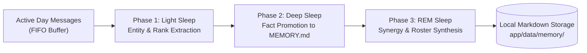

# Product Requirements Document: OpenClaw Hybrid Agentic Co-Processor

**Status**: Proposed / Specification  
**Target Platform**: `discord-bot` (Node.js 22, TypeScript 5, Discord.js v14, OpenClaw Gateway, Directus 12 / Docker)  
**Document Stage**: Stage 1 (PRD)  
**Authors**: Antigravity & Hung Nguyen  
**Date**: 2026-10-17  

---

## 1. Executive Summary & Problem Statement

### 1.1 Context & Background
The `discord-bot` platform serves an active gaming community ("Bluegon Land"). It provides core gaming capabilities, including full-duplex sub-650ms `VoiceCompanionCapability` (utilizing Gemini Live API and Discord DAVE MLS voice encryption), `ValorantCapability`, `MatchmakingCapability`, `RoleCapability`, and `VoiceBouncerCapability`.

While the bot excels at real-time audio and event-driven Discord interactions, its conversational AI engine (`ChatCapability`) operates under a **reactive, single-turn LLM paradigm**:
1. **Single-Turn Limitation**: When complex questions or requests are posed (e.g. evaluating tournament eligibility, researching meta agent counters, or querying game server status), the bot makes a single LLM call with a shallow context window, lacking multi-step reasoning, intermediate tool retries, or execution scratchpads.
2. **Ephemeral Context Window**: Conversation memory uses a FIFO sliding window (last 20–40 turns). Important gaming records—such as a player's agent pool, competitive rank milestones, favorite duo partners, scrim match outcomes, and server inside jokes—are forgotten as conversations move forward.
3. **Rigid Tooling Silo**: Adding new gaming capabilities requires hardcoding TypeScript schemas and executors directly into `app/src/tools/`. The bot cannot tap into modern external gaming tools or open protocols like the Model Context Protocol (MCP).
4. **Context Bloat During Heavy Workloads**: Complex, data-heavy requests (e.g. scrim matchmaking balancing or full-bracket tournament tracking) bloat the single chat context, eating token budgets and freezing channel conversation.
5. **Lack of Human-in-the-Loop Guardrails**: When AI tools interact with Discord management (creating channels, modifying roles, or moving members), there is no interactive confirmation flow to prevent unintended actions.

### 1.2 Objectives & Value Proposition
The **OpenClaw Hybrid Agentic Co-Processor** integrates [OpenClaw](https://openclaw.ai) as an upstream autonomous brain co-located alongside the Discord bot inside Docker Compose. The bot retains 100% of its native Discord infrastructure and low-latency voice, while unlocking:

1. **Dual-Mode Gaming MCP Bridge**: Dynamic access to competitive telemetry (Valorant, TFT), esports schedules (VLR.gg, Liquipedia), community game servers (Steam A2S protocol), stream alerts (Twitch), and game wikis. All tools operate in **dual mode**: leveraging official API keys when provided, while falling back seamlessly to keyless public scraping endpoints so the bot works immediately out of the box.
2. **Specialist Gaming Subagents**: Isolated background workers (`ValorantCoachSubagent`, `ScrimCoordinatorSubagent`, `TournamentRefereeSubagent`) that process complex analysis in parallel workspaces and report back concise summaries without polluting Discord chat.
3. **Biological 3-Phase Gaming Memory ("Dreaming")**: Nightly consolidation (Light Sleep -> Deep Sleep -> REM Sleep) promoting active player facts, tournament lore, and duo synergies into persistent **local markdown files (`MEMORY.md` and `players/{userId}.md`)**.
4. **User Privacy Suite (`/privacy`)**: Users are **opted in by default** for player profiling to deliver personalized gaming context immediately, with full user control via `/privacy opt-out`, `/privacy opt-in`, `/privacy status`, and `/privacy purge`.
5. **Interactive Discord Guardrails with Dynamic Role Authorization**: Sensitive Discord actions trigger an interactive confirmation card with `[Approve Action]` / `[Reject Action]` buttons, enforceable by Discord `ADMINISTRATOR`s and configurable roles added on the fly.
6. **Extensible Cron Groundwork Substrate**: A robust scheduling engine ready for future background tasks without activating unrequested jobs on startup.

---

## 2. User Personas & User Stories

### 2.1 Personas
* **The Competitive Grinder ("Hung")**: Ascendant/Immortal Duelist main. Cares about real-time rank tracking, clutch statistics, agent counters, and having the bot remember his weapon preferences and main champions across seasons.
* **The Scrim Captain / Tournament Admin ("Dung")**: Coordinates 10-man custom lobbies and weekend tournaments. Needs the bot to fetch player ranks, calculate balanced teams, record tournament results, and request admin approvals before creating scrim voice channels.
* **The Community Gamer ("Linh")**: Plays various multiplayer titles (Palworld, CS2, Minecraft). Wants to quickly ping community game servers to see who is online and check if friends are streaming on Twitch.
* **The Privacy-Conscious Member ("Nam")**: Enjoys casual server banter but wants complete visibility and control over what the bot remembers about him, with the ability to opt out or wipe his profile instantly.

### 2.2 User Stories
* **US-OC1 (Live Player & Esports Lookups)**: As a player, I want to ask `@bot check stats for TenZ#0000` or `@bot when is the next VCT Americas match?` so that I get accurate, live esports intelligence even if the server admin hasn't configured commercial API keys.
* **US-OC2 (Autonomous Team Comp Coaching)**: As a 5-stack captain, I want to ask `@bot review our team comp on Ascent against double-initiator` so that a specialist coach subagent evaluates agent synergies in the background and delivers a 3-bullet counter-strategy.
* **US-OC3 (Community Game Server Query)**: As a server member, I want to ask `@bot is the Palworld/Minecraft server online?` so that the bot pings our dedicated server via Steam A2S and returns the current map, player count, and latency.
* **US-OC4 (Biological Memory Continuity)**: As a frequent player, I want the bot to remember that I play Controller/Omen, my peak rank, and my frequent duo partner without me repeating it every week.
* **US-OC5 (User Privacy & Memory Purge)**: As a user, I want to run `/privacy status` to see what facts the bot has stored about me, `/privacy opt-out` to disable long-term memory, or `/privacy purge` to permanently erase my profile.
* **US-OC6 (Interactive Guardrail Approvals)**: As a server admin, I want destructive AI tool calls (e.g. channel creation, role alterations) to present an interactive approval card in Discord requiring an admin or designated role to approve within 60 seconds before executing.
* **US-OC7 (Dynamic Approval Roles on the Fly)**: As an admin, I want to configure additional Discord roles (e.g. `@Tournament Admin`, `@Moderator`) on the fly so trusted organizers can approve tool actions without granting full server Administrator permissions.

---

## 3. Product Specifications & Features

### 3.1 Dual-Mode Gaming MCP Tool Catalog

All tools automatically adapt to available environment variables:

| Tool Identifier | Domain | API Mode (When Key Provided) | Keyless Fallback Mode (Default) | Permission Level |
|---|---|---|---|:---:|
| **`mcp_valorant_tracker`** | Valorant | HenrikDev / Tracker.gg API (`TRACKER_GG_API_KEY`) | VLR.gg & Liquipedia scraping for rank, KDA, winrate | Public |
| **`mcp_esports_vlr`** | VCT & Tournaments | Riot Esports API (`RIOT_API_KEY`) | VLR.gg live match & bracket scraper | Public |
| **`mcp_steam_gameserver`**| Game Servers | Steam Web API (`STEAM_API_KEY`) | Valve A2S UDP protocol direct ping to game server IP | Public |
| **`mcp_twitch_streamer`** | Streams | Twitch Helix API (`TWITCH_CLIENT_ID`) | Decapi & public stream status proxies | Public |
| **`mcp_gaming_wiki`** | Game Mechanics | Wiki API endpoints | Web scraper for agent damage, TFT comps, patch diffs | Public |
| **`discord_admin_tools`** | Discord Management | Discord.js REST client | Discord.js REST client | **Privileged** (Interactive Approval) |

---

### 3.2 Specialist Gaming Subagents

The primary bot agent runtime delegates heavy reasoning to isolated specialist subagents:

1. **`ValorantCoachSubagent`**:
   - *Trigger*: Queries involving team compositions, map strategy, economy planning, and agent counter-picks.
   - *Behavior*: Queries `mcp_gaming_wiki` and `mcp_valorant_tracker`, simulates agent matchups, and outputs a concise 3-bullet tactical brief.
2. **`ScrimCoordinatorSubagent`**:
   - *Trigger*: Custom 5v5 lobby organization and team balancing requests.
   - *Behavior*: Pulls player ranks and recent win rates for the 10 lobby participants, calculates an Elo balance score, and outputs optimal Team Alpha vs Team Omega rosters.
3. **`TournamentRefereeSubagent`**:
   - *Trigger*: Match result submissions, score disputes, and bracket advancement.
   - *Behavior*: Verifies submitted score screenshots or match IDs against VLR/tracker endpoints and updates tournament standings.

---

### 3.3 Biological 3-Phase Gaming Memory ("Dreaming")

Memory consolidation runs as a non-blocking background process during low-activity hours (default: 03:00 AM server time):

#### Phase 1: Light Sleep (Scanning & Entity Extraction)
- Inspects channel messages and roast logs from the previous 24 hours.
- Skips messages from users flagged in `opt-outs.json`.
- Extracts structured gaming entities: in-game name, agent mains, rank promotions/demotions, preferred roles, and tournament outcomes.

#### Phase 2: Deep Sleep (Consolidation & Markdown Storage)
- Filters transient conversational noise (e.g., "be right back", food orders).
- Formats consolidated facts into durable markdown documents:
  - `app/data/memory/{guildId}/MEMORY.md`: Server-wide lore, tournament records, custom rules, and recurring running jokes.
  - `app/data/memory/{guildId}/players/{userId}.md`: Personal player dossier including verified Riot ID, main agents, playstyle tags, and peak ranks.

#### Phase 3: REM Sleep (Associative Synthesis)
- Discovers relational connections across player dossiers (e.g. "Hung and Dung have an 80% win rate when pairing Omen and Sova").
- Appends relational synergy tags to both player dossiers.

---

### 3.4 User Privacy Suite (`/privacy`)

Privacy is a first-class feature with complete self-service transparency:

| Subcommand | Parameters | Default State | Description |
|---|---|---|---|
| `/privacy status` | None | Active | Displays the user's current profiling status, opt-in date, and a summary of recorded facts. |
| `/privacy opt-out` | None | — | Flags user in `opt-outs.json`. Immediately halts future memory indexing and dreaming for this user. |
| `/privacy opt-in` | None | Opted In by Default | Re-enables memory dreaming and player profiling. |
| `/privacy purge` | `[confirm: true]` | — | Permanently deletes `players/{userId}.md` and scrubs the user's name from `MEMORY.md`. |

---

### 3.5 Interactive Guardrails & Dynamic Role Authorization

Privileged actions (such as channel creation/deletion, role modifications, kicks/bans, or guild configuration overrides) must pass through a two-step verification flow:

1. **Permission Check**: The initiating user must either possess Discord's `ADMINISTRATOR` permission or hold an authorized approval role.
2. **Interactive Confirmation Card**: The bot posts an action approval card in the Discord channel:
   - Displays the exact action: *"Bot is requesting to create voice channel 'Scrims Room 1'"*.
   - Displays who requested it and the action parameters.
   - Provides two interactive buttons: `[Approve Action]` (Green) and `[Reject Action]` (Red).
   - Enforces a **60-second expiration timeout**.
3. **Dynamic Role Configuration on the Fly**:
   - Admins can authorize additional non-admin roles to approve tool actions without granting full server Administrator rights.
   - Command: `/config tool-approvals add-role @TournamentAdmin` or `/config tool-approvals remove-role @Role`.
   - Stored in guild configuration and evaluated instantly during button interactions.

---

### 3.6 Scheduled Agentic Cron Groundwork

Provides the architectural substrate and execution lifecycle for scheduled background agent operations:
- Standard 5-field cron expression parser (`cron-parser`).
- In-memory execution lock (mutex) preventing overlapping task runs.
- Error boundary isolating individual task failures from crashing the bot.
- **Zero active jobs on initial boot**: Framework is loaded, tested, and fully dormant until concrete tasks are scheduled in future updates.

---

## 4. Product Success Metrics (KPIs)

1. **Esports & Stats Query Latency**: Under 2.0 seconds for keyless scraping fallbacks; under 800ms for direct API responses.
2. **Subagent Execution Isolation**: 100% of complex tactical queries processed through subagents without increasing the parent channel token count by more than 150 tokens.
3. **Dreaming Retention Accuracy**: Over 90% of high-confidence player preferences (main role, rank, duo) accurately consolidated into `players/{userId}.md`.
4. **Privacy Compliance**: Zero recorded facts for users who executed `/privacy opt-out`; instantaneous file deletion upon `/privacy purge`.
5. **Guardrail Safety**: 0 unauthorized executions of privileged tools; 100% rejection rate for clicks from non-authorized users.
