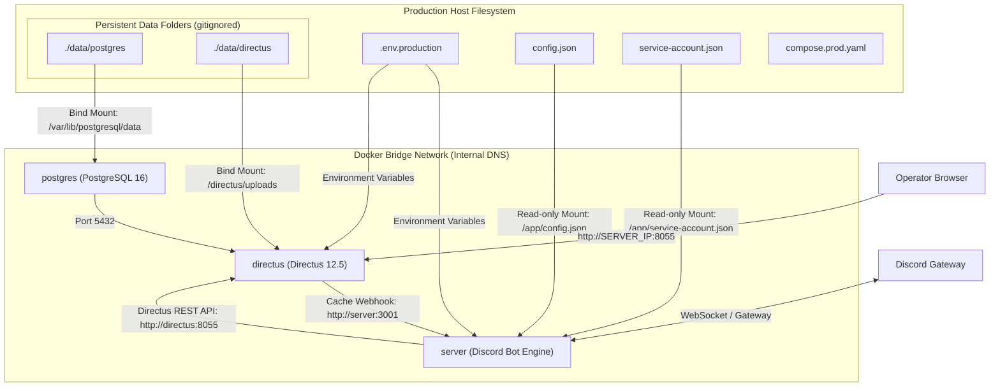

# Production Docker Deployment & Directus Control Plane Guide

Complete guide for deploying the Discord bot platform with its Directus Headless CMS control plane in production using Docker Compose.

---

## 1. Architecture Overview

The production stack runs as a unified Docker Compose project consisting of three interconnected services communicating over an internal bridge network:



### Key Components
- **`postgres`**: PostgreSQL 16 database storing Directus schema, collections, user settings, audit logs, and relations. Data persists on the host at `./data/postgres`.
- **`directus`**: Directus 12 Headless CMS providing the administrative control plane at port `8055`. Media uploads persist on the host at `./data/directus`.
- **`server`**: Discord bot container (`ghcr.io/nthungdev/discord-bot:latest`) listening on port `3001`.
- **Internal Service DNS**:
  - `server` reaches Directus at `http://directus:8055`.
  - `directus` triggers cache invalidation webhooks on `server` at `http://server:3001/api/v1/webhooks/cache-invalidate`.
  - `directus` connects to PostgreSQL at `postgres:5432`.

---

## 2. Directory Structure on Host

On your production host server, set up the project directory:

```
~/discord-bot/ (or /opt/discord-bot/)
├── compose.prod.yaml         # Production Docker Compose specification
├── .env.production           # Production environment variables
├── config.json               # Bot configuration JSON
├── service-account.json      # Google Cloud / Firebase credentials
└── data/                     # Persistent shared folders (created automatically or manually)
    ├── postgres/             # PostgreSQL database data files
    └── directus/             # Directus uploaded assets & files
```

---

## 3. Deployment Steps

### Step 1: Prepare Directory on Host

Connect to your server via SSH and create the project structure:

```bash
ssh <user>@<server_host>

# Create deployment directory and data bind mount folders
mkdir -p ~/discord-bot/data/postgres ~/discord-bot/data/directus
cd ~/discord-bot

# Ensure permissions allow containers to write to data folders
chmod -R 775 data
```

### Step 2: Transfer Configuration Files

From your local machine or CI/CD runner, copy the configuration files:

```bash
# Run from repository root:
scp compose.prod.yaml <user>@<server_host>:~/discord-bot/compose.prod.yaml
scp app/.env.production <user>@<server_host>:~/discord-bot/.env.production
scp app/config.json <user>@<server_host>:~/discord-bot/config.json
scp app/service-account.json <user>@<server_host>:~/discord-bot/service-account.json
```

### Step 3: Configure Environment Variables

Edit `.env.production` on the server and verify all required settings:

```ini
# ==============================================================================
# Discord & AI Credentials
# ==============================================================================
DISCORD_TOKEN=your_production_discord_bot_token
CLIENT_ID=your_discord_application_client_id
AI_API_KEY=your_google_gemini_api_key
BEARER_TOKEN=your_secure_random_bearer_token

# ==============================================================================
# Directus Core & Security Secrets (32+ chars random strings)
# ==============================================================================
DIRECTUS_KEY=generate_random_32_characters_key_here
DIRECTUS_SECRET=generate_random_32_characters_secret_here
DIRECTUS_ADMIN_EMAIL=admin@example.com
DIRECTUS_ADMIN_PASSWORD=YourStrongAdminPassword123!
DIRECTUS_PUBLIC_URL=http://<SERVER_IP>:8055

# ==============================================================================
# Bot & Directus Integration (Internal Docker Networking)
# ==============================================================================
MEMORY_STORE_TYPE=directus
DIRECTUS_URL=http://directus:8055
DIRECTUS_BOT_TOKEN=generate_random_32_char_service_token
INTERNAL_WEBHOOK_SECRET=generate_random_32_char_webhook_secret
WEBHOOK_RECEIVER_URL=http://server:3001/api/v1/webhooks/cache-invalidate

# ==============================================================================
# PostgreSQL Database Settings
# ==============================================================================
POSTGRES_USER=directus
POSTGRES_PASSWORD=your_secure_postgres_password
POSTGRES_DB=directus

# ==============================================================================
# Optional: Auto-Deploy Slash Commands on Bot Startup
# ==============================================================================
AUTO_DEPLOY_COMMAND_GUILDS=your_target_discord_guild_id
```

### Step 4: Pull and Start Containers

In your deployment directory, run:

```bash
# Pull the latest images
docker compose -f compose.prod.yaml pull

# Start containers in background
docker compose -f compose.prod.yaml up -d

# Verify all containers are running and healthy
docker compose -f compose.prod.yaml ps
```

---

## 4. First-Time Directus Setup

When running Directus for the first time on a fresh database, follow this sequence:

### 1. Wait for Directus Initialization

On its first run, Directus automatically creates all system tables in PostgreSQL:

```bash
docker compose -f compose.prod.yaml logs -f directus
```

Wait until you see:
```text
Server started on port 8055
```
Press `Ctrl+C` to exit log streaming.

### 2. Run the Automated Bootstrap Script

Execute the provisioning script inside the running `server` container:

```bash
docker compose -f compose.prod.yaml exec server node build/src/scripts/setupDirectus.js
```

**Expected output:**
```text
Connecting to Directus at http://directus:8055...
Logged in as admin.
Provisioning collections and fields...
Creating bot-service-policy...
Creating bot-service role...
Creating bot-service user with static token...
Seeding default roast preset...
Provisioning cache invalidation flow...
Provisioning cache invalidation webhook operation...
Directus setup completed successfully!
```

> [!NOTE]
> What this script sets up:
> - **Collections**: `bot_guild_configs`, `bot_roast_presets`, `bot_user_profiles`, `bot_roast_logs`, `bot_match_logs`.
> - **RBAC Policy**: `bot-service-policy` with CRUD permissions for bot operations.
> - **Service Role & User**: `bot-service` role and `bot-service@local.dev` user authenticated with `DIRECTUS_BOT_TOKEN`.
> - **AI Preset**: Default system prompt preset for AI roasts.
> - **Flow & Operation**: Webhook dispatching to `http://server:3001/api/v1/webhooks/cache-invalidate` with `x-webhook-secret` header.

### 3. Log In to the Directus Web Admin

1. Open your browser and navigate to: `http://<SERVER_IP>:8055`
2. Sign in with:
   - **Email**: Value of `DIRECTUS_ADMIN_EMAIL`
   - **Password**: Value of `DIRECTUS_ADMIN_PASSWORD`

### 4. Configure Your Discord Server (`bot_guild_configs`)

1. Click the **Content** icon (cube) on the left sidebar.
2. Select **Bot Guild Configs** (`bot_guild_configs`).
3. Click **+ Create Item**:
   - `guild_id`: Your Discord Guild/Server ID Snowflake.
   - `guild_name`: Friendly server name.
   - `enable_ai_roast`: `true` (toggle on).
   - `default_locale`: `vi` (Vietnamese) or `en` (English).
   - `allowed_channel_ids`: Leave empty to allow everywhere, or enter specific channel snowflakes.
4. Click the checkmark icon to **Save**.

### 5. Review / Customize AI Roast Presets (`bot_roast_presets`)

1. In **Content**, click **Bot Roast Presets**.
2. Notice the `default` preset seeded by the bootstrap script.
3. Customize the `system_prompt` tone, change temperature, or add new presets.

### 6. Verify Automated Cache Invalidation

1. In the bottom-left sidebar, click **Settings** (gear icon) > **Flows**.
2. Verify that **`bot-cache-invalidation`** is listed with status **Active**.
3. In a terminal, stream bot logs:
   ```bash
   docker compose -f compose.prod.yaml logs -f server
   ```
4. In Directus Web Admin, edit any field in `bot_guild_configs` (e.g. toggle `enable_ai_roast`) and click **Save**.
5. You should immediately see in the `server` logs:
   ```text
   [Webhook] Cache invalidated for collection: bot_guild_configs
   ```
   This confirms that runtime configuration changes take effect instantly with zero downtime!

---

## 5. Maintenance & Useful Commands

### Stream Container Logs
```bash
# All containers
docker compose -f compose.prod.yaml logs -f

# Specific container
docker compose -f compose.prod.yaml logs -f server
docker compose -f compose.prod.yaml logs -f directus
docker compose -f compose.prod.yaml logs -f postgres
```

### Redeploy / Update Bot Container
When a new container image is published:
```bash
docker compose -f compose.prod.yaml pull server
docker compose -f compose.prod.yaml up -d server
```

### Restarting the Entire Stack
```bash
docker compose -f compose.prod.yaml restart
```

### Stopping the Stack
```bash
# Stop containers (preserves all data in ./data/)
docker compose -f compose.prod.yaml down

# Stop and wipe database (CAUTION: deletes all data)
docker compose -f compose.prod.yaml down -v
```
