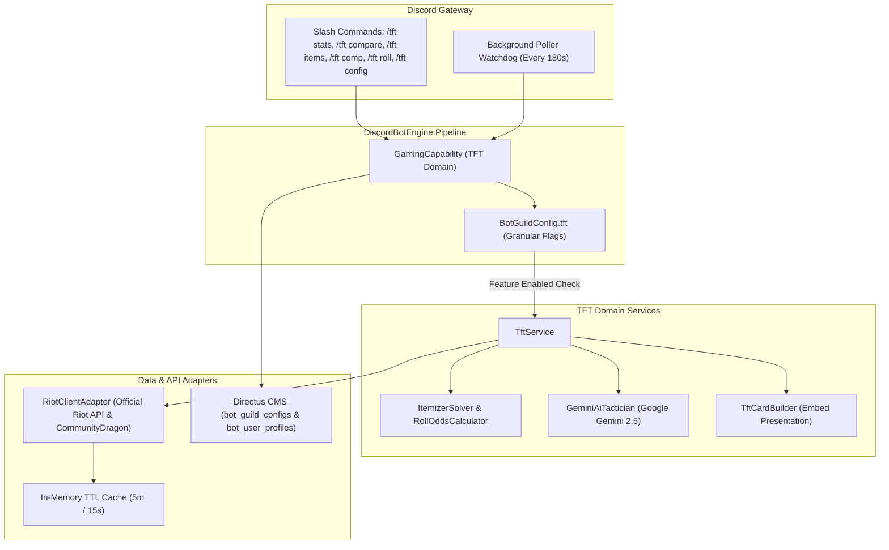

# Technical Design Document: Teamfight Tactics (TFT) Capability Suite

**Author**: Antigravity & Hung Nguyen  
**Status**: Proposed / Design Specification  
**Target Platform**: `discord-bot` (Node.js 22, TypeScript 5, Discord.js v14, Directus 12 / Firestore)  
**Document Stage**: Stage 2 (TDD)  
**PRD Reference**: [`docs/tft-prd.md`](./tft-prd.md)  
**Date**: 2026-10-15  

---

## 1. System Architecture & Component Interaction

The **TFT Capability** operates as a specialized domain engine inside `DiscordBotEngine`:



---

## 2. Granular Configuration Schema

### 2.1 Configuration Interface (`app/src/config/types.ts`)

```typescript
export interface TftFeaturesConfig {
  statsSummary?: {
    enabled?: boolean;
    defaultPeriod?: "current_set" | "recent_20" | "all_time";
  };
  compare?: {
    enabled?: boolean;
  };
  itemizer?: {
    enabled?: boolean;
  };
  compAdvisor?: {
    enabled?: boolean;
  };
  rollOdds?: {
    enabled?: boolean;
  };
  autoRecap?: {
    enabled?: boolean;
    channelId?: string;
    minPlacementForCelebration?: number; // default: 1 (1st place)
    sportscasterBanter?: boolean;
  };
  rankRoleSync?: {
    enabled?: boolean;
    roleMappings?: Record<string, string>; // e.g. { "challenger": "role_id" }
  };
}

export interface TftCapabilityConfig {
  enabled?: boolean;
  features?: TftFeaturesConfig;
}

export interface BotGuildConfig {
  // Existing configs...
  tft?: TftCapabilityConfig;
}
```

### 2.2 Feature Guard Helper
```typescript
/**
 * Evaluates whether a specific TFT sub-feature is active for a guild.
 */
export function isTftFeatureEnabled(
  guildConfig: BotGuildConfig | undefined,
  feature: keyof TftFeaturesConfig,
): boolean {
  if (!guildConfig?.tft?.enabled) return false;
  const features = guildConfig.tft.features;
  if (!features) return true; // Default to enabled if no explicit sub-feature map
  const subFeature = features[feature] as { enabled?: boolean } | undefined;
  return subFeature?.enabled !== false;
}
```

---

## 3. Data Models & TypeScript Interfaces

### 3.1 Personal Stats Summary Data Transfer Object
```typescript
export interface TftPersonalSummary {
  puuid: string;
  gameName: string;
  tagLine: string;
  tier: string;
  rank: string;
  leaguePoints: number;
  period: "current_set" | "recent_20" | "all_time";
  totalMatches: number;
  wins: number; // 1st place finishes
  top4Count: number;
  winRatePct: number;
  top4RatePct: number;
  avgPlacement: number;
  netLpDelta: number;
  placementDistribution: {
    first: number;
    second: number;
    third: number;
    fourth: number;
    fifth: number;
    sixth: number;
    seventh: number;
    eighth: number;
  };
  topComps: {
    traitName: string;
    matches: number;
    avgPlacement: number;
    top4Rate: number;
  }[];
  aiTacticianVerdict?: {
    strength: string;
    weakness: string;
    actionableTip: string;
  };
}

export interface TftCraftableItem {
  name: string;
  componentA: string;
  componentB: string;
  tier: "S" | "A" | "B";
  description: string;
  bestCarries: string[];
}
```

---

## 4. Algorithms & Mathematical Formulations

### 4.1 Roll-Down Probability Calculator
The probability of obtaining at least $k$ copies of a specific target unit of cost $C$ when rolling $G$ gold (granting $N = \lfloor G / 2 \rfloor$ shop rerolls of 5 slots each) at level $L$:

Let:
- $S = 5 \times N$ (total unit slots seen).
- $P_{\text{tier}}(C, L)$ = probability that a shop slot at level $L$ rolls cost $C$.
- $U_{\text{target}}$ = remaining copies of target unit in the shared pool.
- $U_{\text{total\_tier}}$ = remaining total units in that cost tier.

Each slot independently draws the target unit with probability:
$$p = P_{\text{tier}}(C, L) \times \frac{U_{\text{target}}}{U_{\text{total\_tier}}}$$

The probability of hitting at least 1 copy:
$$P(X \ge 1) = 1 - (1 - p)^S$$

For rolling down to 2-star (3 copies):
$$P(X \ge 3) = 1 - \sum_{j=0}^{2} \binom{S}{j} p^j (1 - p)^{S - j}$$

### 4.2 Bench Itemizer Solver
Given input array of component strings $B = [c_1, c_2, \dots, c_m]$:
1. Generate all unordered pairs $(c_i, c_j)$ for $1 \le i < j \le m$.
2. Lookup recipes in the static CommunityDragon item recipe table.
3. Deduplicate crafts, rank by meta tier ($S > A > B$), and suggest best champions.

---

## 5. Domain Service Layer: `TftService`

### 5.1 Personal Stats Aggregation
1. Resolves player PUUID via `DirectusUserProfileRepository`.
2. Queries last 20 match IDs via `RiotClientAdapter.getTftMatchIds(puuid, region)`.
3. Ingests participants payload:
   - Increments placement distribution counter (`placementDistribution[placement]++`).
   - Computes weighted average placement: $\bar{P} = \frac{1}{N} \sum_{i=1}^N P_i$.
   - Aggregates traits with tier $> 0$ and associates them with the match placement.
4. Invokes Google Gemini 2.5 Flash for tactical coaching:
   ```typescript
   const prompt = `
   You are an analytical, high-level Teamfight Tactics challenger tactician reviewing a player's recent 20 ranked games:
   Player: ${summary.gameName}#${summary.tagLine}
   Rank: ${summary.tier} ${summary.rank} (${summary.leaguePoints} LP)
   Avg Placement: ${summary.avgPlacement} | Top 4 Rate: ${summary.top4RatePct}% | 1st Place Rate: ${summary.winRatePct}%
   Placement Distribution: 1st: ${summary.placementDistribution.first}, 2nd: ${summary.placementDistribution.second}, 3rd: ${summary.placementDistribution.third}, 4th: ${summary.placementDistribution.fourth}, 5th: ${summary.placementDistribution.fifth}, 6th: ${summary.placementDistribution.sixth}, 7th: ${summary.placementDistribution.seventh}, 8th: ${summary.placementDistribution.eighth}
   Top Comps: ${summary.topComps.map(c => `${c.traitName} (Avg: ${c.avgPlacement})`).join(", ")}

   Respond in JSON:
   {
     "strength": "1 concise sentence praising their tempo or high-roll execution.",
     "weakness": "1 concise sentence identifying why they bleed out or struggle.",
     "actionableTip": "1 concrete advice on stage 2 econ, augment choices, or pivot discipline."
   }
   `;
   ```

---

## 6. Presentation Layer: `TftCardBuilder`

Generates high-contrast Discord Embeds with placement distribution histograms:

```typescript
export class TftCardBuilder {
  static buildPersonalSummaryEmbed(summary: TftPersonalSummary): EmbedBuilder {
    const dist = summary.placementDistribution;
    const histogram = `🥇 1st: [${dist.first}]  🥈 2nd: [${dist.second}]  🥉 3rd: [${dist.third}]  4th: [${dist.fourth}]\n5th:    [${dist.fifth}]  6th:    [${dist.sixth}]  7th:    [${dist.seventh}]  💀 8th: [${dist.eighth}]`;

    return new EmbedBuilder()
      .setColor(summary.avgPlacement <= 4.0 ? 0x22c55e : 0xf59e0b)
      .setTitle(`♟️ TFT Tactical Summary: ${summary.gameName}#${summary.tagLine}`)
      .setDescription(`**${summary.tier} ${summary.rank}** (${summary.leaguePoints} LP)\n*Period: ${summary.period}*`)
      .addFields(
        {
          name: "📈 Placement Distribution",
          value: `\`\`\`text\n${histogram}\n\`\`\``,
          inline: false,
        },
        {
          name: "🎯 Tactical KPIs",
          value: `**Avg Placement**: ${summary.avgPlacement}\n**Top 4 Rate**: ${summary.top4RatePct}%\n**Win Rate**: ${summary.winRatePct}%\n**Net LP**: ${summary.netLpDelta >= 0 ? "📈 +" : "📉 "}${summary.netLpDelta} LP`,
          inline: true,
        },
        {
          name: "👑 Top Compositions",
          value: summary.topComps.slice(0, 3).map(c => `• **${c.traitName}**: Avg **${c.avgPlacement}** (${c.matches} games)`).join("\n"),
          inline: true,
        },
        {
          name: "🧠 AI Tactician's Review",
          value: `🌟 **Strength**: ${summary.aiTacticianVerdict?.strength}\n⚠️ **Weakness**: ${summary.aiTacticianVerdict?.weakness}\n💡 **Tactician Tip**: ${summary.aiTacticianVerdict?.actionableTip}`,
          inline: false,
        }
      );
  }
}
```

## 7. Directus Schema & Storage Strategy

In Directus CMS, guild configurations are persisted in `bot_guild_configs`:
- `tft_enabled`: Boolean (master toggle for TFT capability).
- `tft_features`: JSON Object field storing the granular sub-feature flags and options:
  ```json
  {
    "statsSummary": { "enabled": true, "defaultPeriod": "current_set" },
    "compare": { "enabled": true },
    "itemizer": { "enabled": true },
    "compAdvisor": { "enabled": true },
    "rollOdds": { "enabled": true },
    "autoRecap": { "enabled": true, "channelId": "123456789012345678", "minPlacementForCelebration": 1 },
    "rankRoleSync": { "enabled": false, "roleMappings": {} }
  }
  ```
Storing feature flags within a JSON object field guarantees forward compatibility and clean schema extensibility without altering database table columns when sub-features evolve.

---

## 8. Verification & Automated Testing Plan

### 7.1 Unit Tests
* **Feature Guard Tests** (`src/config/__tests__/tft-feature-guards.test.ts`):
  - Verify `isTftFeatureEnabled` flags behavior across all 7 sub-features.
* **Itemizer Tests** (`src/services/riot/__tests__/tft-itemizer.test.ts`):
  - Component combination accuracy for all base items.
* **Roll Probability Tests** (`src/services/riot/__tests__/tft-roll.test.ts`):
  - Mathematical precision against Riot official shop odds.
* **Placement Arithmetic Tests** (`src/services/riot/__tests__/tft-stats.test.ts`):
  - Accurate calculation of average placement and Top 4 rate.
