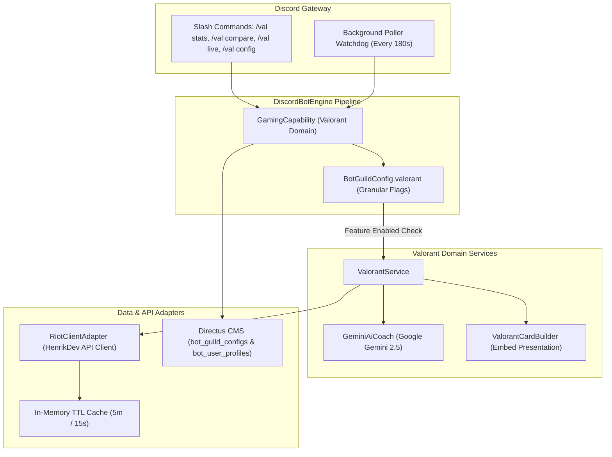

# Technical Design Document: Valorant Capability Suite

**Author**: Antigravity & Hung Nguyen  
**Status**: Proposed / Design Specification  
**Target Platform**: `discord-bot` (Node.js 22, TypeScript 5, Discord.js v14, Directus 12 / Firestore)  
**Document Stage**: Stage 2 (TDD)  
**PRD Reference**: [`docs/valorant-prd.md`](./valorant-prd.md)  
**Date**: 2026-10-15  

---

## 1. System Architecture & Component Interaction

The **Valorant Capability** runs as a modular domain engine inside `DiscordBotEngine`:



---

## 2. Granular Configuration Schema

### 2.1 Configuration Interface (`app/src/config/types.ts`)

```typescript
export interface ValorantFeaturesConfig {
  compare?: {
    enabled?: boolean;
  };
  statsSummary?: {
    enabled?: boolean;
    defaultPeriod?: "recent_20" | "current_act" | "all_time";
  };
  autoRecap?: {
    enabled?: boolean;
    channelId?: string;
    minTierAlert?: number;
    sportscasterBanter?: boolean;
  };
  liveScouting?: {
    enabled?: boolean;
    channelId?: string;
    alertOnGameStart?: boolean;
  };
  rankRoleSync?: {
    enabled?: boolean;
    roleMappings?: Record<string, string>; // e.g. { "immortal": "role_id" }
  };
  tiltProtection?: {
    enabled?: boolean;
    consecutiveLossesThreshold?: number; // default: 3
    nightOwlHourStart?: number; // default: 1 (1 AM)
    nightOwlHourEnd?: number; // default: 5 (5 AM)
    dmAlert?: boolean;
  };
}

export interface ValorantCapabilityConfig {
  enabled?: boolean;
  features?: ValorantFeaturesConfig;
}

export interface BotGuildConfig {
  // Existing configs...
  valorant?: ValorantCapabilityConfig;
}
```

### 2.2 Feature Guard Helper
```typescript
/**
 * Evaluates whether a specific Valorant sub-feature is active for a guild.
 */
export function isValorantFeatureEnabled(
  guildConfig: BotGuildConfig | undefined,
  feature: keyof ValorantFeaturesConfig,
): boolean {
  if (!guildConfig?.valorant?.enabled) return false;
  const features = guildConfig.valorant.features;
  if (!features) return true; // Default to enabled if no explicit sub-feature map
  const subFeature = features[feature] as { enabled?: boolean } | undefined;
  return subFeature?.enabled !== false;
}
```

---

## 3. Data Models & TypeScript Interfaces

### 3.1 Personal Stats Summary Data Transfer Object
```typescript
export interface ValorantPersonalSummary {
  puuid: string;
  gameName: string;
  tagLine: string;
  currentRank: string;
  currentTier: number;
  currentRR: number;
  peakRank: string;
  peakTier: number;
  period: "recent_20" | "current_act" | "all_time";
  matchesEvaluated: number;
  wins: number;
  losses: number;
  winRatePct: number;
  netRrDelta: number;
  kdRatio: number;
  totalKills: number;
  totalDeaths: number;
  totalAssists: number;
  headshotPct: number;
  bodyPct: number;
  legPct: number;
  avgCombatScore: number;
  avgDamagePerRound: number;
  firstBloodsPerMatch: number;
  firstDeathsPerMatch: number;
  clutchStats: {
    v1: { won: number; total: number; winRate: number };
    v2: { won: number; total: number; winRate: number };
    v3Plus: { won: number; total: number; winRate: number };
  };
  topAgents: {
    agentName: string;
    matches: number;
    winRate: number;
    kd: number;
  }[];
  mapStats: {
    bestMap: { name: string; winRate: number; matches: number };
    worstMap: { name: string; winRate: number; matches: number };
  };
  aiCoachVerdict?: {
    strength: string;
    weakness: string;
    actionableTip: string;
  };
}
```

---

## 4. Domain Service Layer: `ValorantService`

### 4.1 Personal Stats Aggregation Algorithm
1. Query user's linked Riot ID from `DirectusUserProfileRepository`.
2. Fetch last 20 competitive matches via `RiotClientAdapter.getValorantMatches(name, tag, region)`.
3. Iterate match segments:
   - Accumulate total damage, rounds played, headshots, body hits, leg hits, kills, deaths, assists.
   - Parse round-by-round clutch flags (`clutch_type: "1v1" | "1v2" | "1v3"`, won/lost).
   - Track agent frequencies and map victory ratios.
   - Calculate net RR delta by summing match RR increments.
4. Construct AI Performance Coaching prompt for Gemini 2.5 Flash:
   ```typescript
   const coachPrompt = `
   You are an analytical, encouraging professional Valorant coach reviewing a player's recent 20 ranked matches:
   Player: ${summary.gameName}#${summary.tagLine}
   Rank: ${summary.currentRank} (Peak: ${summary.peakRank})
   KD: ${summary.kdRatio} | HS%: ${summary.headshotPct}% | ACS: ${summary.avgCombatScore} | ADR: ${summary.avgDamagePerRound}
   First Bloods/Match: ${summary.firstBloodsPerMatch} | First Deaths/Match: ${summary.firstDeathsPerMatch}
   Win Rate: ${summary.winRatePct}% (Net RR: ${summary.netRrDelta >= 0 ? "+" : ""}${summary.netRrDelta} RR)
   Top Agents: ${summary.topAgents.map(a => `${a.agentName} (${a.winRate}%)`).join(", ")}
   Best Map: ${summary.mapStats.bestMap.name} (${summary.mapStats.bestMap.winRate}%) | Worst Map: ${summary.mapStats.worstMap.name} (${summary.mapStats.worstMap.winRate}%)

   Respond in JSON with three keys:
   {
     "strength": "1 concise sentence praising their primary mechanical or tactical strength.",
     "weakness": "1 concise sentence highlighting their primary weakness (e.g. dying early, map struggle).",
     "actionableTip": "1 concrete positioning or warmup drill tip."
   }
   `;
   ```

---

## 5. Presentation Layer: `ValorantCardBuilder`

Generates high-contrast Discord Embeds with visual progress bars and rank icons:

```typescript
export class ValorantCardBuilder {
  static buildPersonalSummaryEmbed(summary: ValorantPersonalSummary): EmbedBuilder {
    const hsBar = buildProgressBar(summary.headshotPct, 50); // e.g. [████████░░░░░░]
    return new EmbedBuilder()
      .setColor(summary.winRatePct >= 50 ? 0x22c55e : 0xef4444)
      .setTitle(`📊 Valorant Performance: ${summary.gameName}#${summary.tagLine}`)
      .setDescription(`**${summary.currentRank}** (${summary.currentRR} RR) • Peak: **${summary.peakRank}**\n*Period: ${summary.period}*`)
      .addFields(
        {
          name: "🎯 Aim & Combat",
          value: `**K/D**: ${summary.kdRatio} (${summary.totalKills}/${summary.totalDeaths})\n**Headshot**: ${summary.headshotPct}% \`${hsBar}\`\n**ACS**: ${summary.avgCombatScore} | **ADR**: ${summary.avgDamagePerRound}`,
          inline: true,
        },
        {
          name: "🏆 Rating & Clutches",
          value: `**Win Rate**: ${summary.winRatePct}% (${summary.wins}W - ${summary.losses}L)\n**Net RR**: ${summary.netRrDelta >= 0 ? "📈 +" : "📉 "}${summary.netRrDelta} RR\n**1v1 Clutch**: ${summary.clutchStats.v1.winRate}%\n**1v2 Clutch**: ${summary.clutchStats.v2.winRate}%`,
          inline: true,
        },
        {
          name: "🗺️ Top Agents & Maps",
          value: `**Agents**: ${summary.topAgents.slice(0, 2).map(a => `${a.agentName} (${a.winRate}%)`).join(", ")}\n**Best Map**: ${summary.mapStats.bestMap.name} (${summary.mapStats.bestMap.winRate}%)\n**Worst Map**: ${summary.mapStats.worstMap.name} (${summary.mapStats.worstMap.winRate}%)`,
          inline: false,
        },
        {
          name: "🧠 AI Performance Coach",
          value: `🌟 **Strength**: ${summary.aiCoachVerdict?.strength}\n⚠️ **Weakness**: ${summary.aiCoachVerdict?.weakness}\n💡 **Coach Tip**: ${summary.aiCoachVerdict?.actionableTip}`,
          inline: false,
        }
      );
  }
}
```

## 6. Directus Schema & Storage Strategy

In Directus CMS, guild configurations are persisted in `bot_guild_configs`:
- `valorant_enabled`: Boolean (master toggle for Valorant capability).
- `valorant_features`: JSON Object field storing the granular sub-feature flags and options:
  ```json
  {
    "compare": { "enabled": true },
    "statsSummary": { "enabled": true, "defaultPeriod": "recent_20" },
    "autoRecap": { "enabled": true, "channelId": "123456789012345678" },
    "liveScouting": { "enabled": true },
    "rankRoleSync": { "enabled": false, "roleMappings": {} },
    "tiltProtection": { "enabled": true, "consecutiveLossesThreshold": 3 }
  }
  ```
Storing feature flags within a JSON object field guarantees forward compatibility and clean schema extensibility without altering database table columns when sub-features evolve.

---

## 7. Verification & Automated Testing Plan

### 6.1 Unit Tests
* **Feature Guard Tests** (`src/config/__tests__/valorant-feature-guards.test.ts`):
  - Verify `isValorantFeatureEnabled` returns `true` when capability is enabled and feature is omitted.
  - Verify returns `false` when specific feature `enabled = false`.
  - Verify returns `false` when global `valorant.enabled = false`.
* **Stats Calculation Tests** (`src/services/riot/__tests__/valorant-stats.test.ts`):
  - Accurate Headshot % with 0 headshots, 0 body, 0 leg hits.
  - Net RR calculation across win/loss sequences.
  - Clutch rate calculations with 0 attempted clutches.
* **AI Coach Prompt Tests** (`src/services/riot/__tests__/valorant-coach.test.ts`):
  - Graceful fallback when Gemini API returns malformed JSON.
