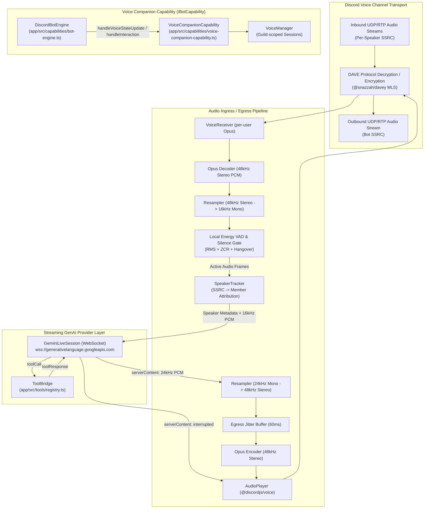
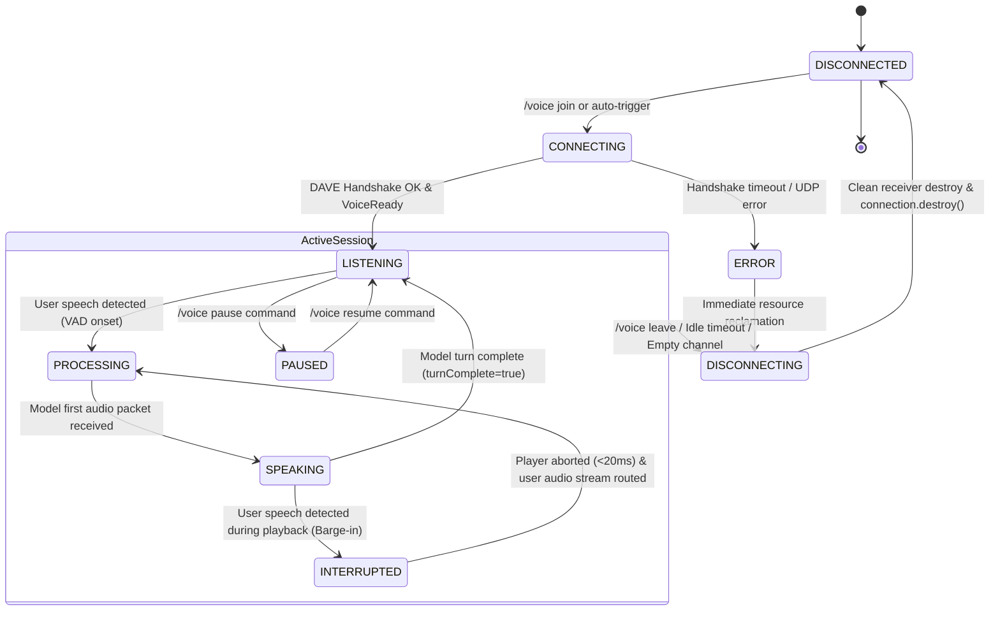

# Architectural Design Document: Voice Companion Capability

## 1. Summary, goals, and non-goals

The Voice Companion capability introduces a full-duplex, real-time conversational voice agent to the Discord bot platform. The bot joins a Discord voice channel, receives multi-speaker Opus audio streams, decodes and downsamples audio with local Voice Activity Detection (VAD), routes speech through a bidirectional streaming session with the Google Gemini Multimodal Live API, and streams synthesized low-latency audio back into Discord with sub-650ms round-trip responsiveness. The architecture natively supports multi-user speaker attribution, client-side and server-side barge-in (interruption), dynamic tool execution mid-conversation, and strict privacy safeguards.

### Goals
- **Full-duplex conversation**: Continuous audio streaming with human-like turn-taking and sub-650ms end-to-end latency (from speech termination to initial bot audio playback).
- **Responsive barge-in**: Instant audio cutoff (<50ms local audio player purge) when a participant interrupts the companion while it is speaking.
- **Accurate speaker attribution**: Demuxing per-speaker RTP streams from Discord's voice transport to attribute "who said what" before sending turns to the model.
- **Configurable participation policies**: Support addressed-only (wake name / hotword), ambient participant, and slash command push-to-talk modes.
- **Mid-conversation tool dispatch**: Reusing the existing repository tool registry in [`app/src/tools/`](../app/src/tools/registry.ts) for real-time actions (channel queries, matchmaking status, web searches).
- **Discord End-to-End Encryption (DAVE) compliance**: Full support for Discord's voice transport encryption using `@snazzah/davey` and `@discordjs/voice`.
- **Zero raw audio persistence**: Ephemeral in-memory ring-buffer processing with complete discard after inference.
- **Architectural parity**: Strict alignment with [`IBotCapability`](../app/src/capabilities/types.ts) and [`DiscordBotEngine`](../app/src/capabilities/bot-engine.ts).

### Non-goals
- **Music or soundboard playback**: The capability is strictly optimized for real-time natural language dialogue; high-fidelity stereo music playback is out of scope.
- **Permanent voice archiving or wiretapping**: Raw user audio will never be written to persistent disks or external storage buckets.
- **Multi-channel audio bridging**: The bot will not bridge or relay audio between separate voice channels.
- **Video or screen-share processing**: Video frame ingestion is deferred to future multimodal phases; audio-to-audio is the sole initial modality.

---

## 2. Architecture overview

The voice companion capability sits between Discord's real-time voice gateway/UDP transport and Google GenAI's WebSocket streaming endpoints. The diagram below illustrates the components, data flow, and session orchestration.

### System architecture and data flow



### Session state machine

Each voice session in a guild executes an isolated finite state machine ensuring clean resource transitions, instant interruption propagation, and predictable teardown.



---

## 3. Component and file layout mapped to repository paths

All components conform strictly to the layout conventions defined in [`AGENTS.md`](../AGENTS.md) and [`app/src/capabilities/types.ts`](../app/src/capabilities/types.ts). Co-located unit tests reside inside nested `__tests__/` directories.

```
app/
├── src/
│   ├── capabilities/
│   │   ├── voice-companion-capability.ts            # Main IBotCapability implementation
│   │   └── __tests__/
│   │       └── voice-companion-capability.test.ts   # Capability lifecycle & event dispatch tests
│   ├── discord/
│   │   ├── constants.ts                             # Extended with DiscordCommand.Voice
│   │   └── commands/
│   │       └── voice/
│   │           ├── companion.ts                     # Slash command /voice [join|leave|pause|resume|status|opt-out]
│   │           └── __tests__/
│   │               └── companion.test.ts            # Slash command argument parsing & execution tests
│   ├── services/
│   │   └── voice/
│   │       ├── constants.ts                         # Audio constants, timing windows, VAD thresholds
│   │       ├── types.ts                             # Session state, participation mode, audio frame types
│   │       ├── voice-manager.ts                     # Guild session registry & concurrency coordinator
│   │       ├── voice-session.ts                     # Core VoiceSession managing connection, audio & VAD
│   │       ├── audio/
│   │       │   ├── audio-resampler.ts               # Resampling (48k <-> 16k/24k), PCM framing, stereo/mono
│   │       │   ├── vad.ts                           # Energy-based RMS/ZCR VAD with hangover state
│   │       │   ├── jitter-buffer.ts                 # Dynamic 60ms outbound jitter buffer
│   │       │   └── __tests__/
│   │       │       ├── audio-resampler.test.ts      # Resampling precision & NaN safety tests
│   │       │       ├── vad.test.ts                  # VAD onset/hangover transition unit tests
│   │       │       └── jitter-buffer.test.ts        # Outbound jitter buffer streaming tests
│   │       ├── speaker/
│   │       │   ├── speaker-tracker.ts               # SSRC to GuildMember mapping & turn management
│   │       │   └── __tests__/
│   │       │       └── speaker-tracker.test.ts      # Speaker attribution mapping unit tests
│   │       ├── streaming/
│   │       │   ├── types.ts                         # IStreamingGenAiSession interface & live event types
│   │       │   ├── gemini-live-session.ts           # Gemini Live WebSocket client (@google/genai)
│   │       │   ├── tool-bridge.ts                   # Bridge executing tools from app/src/tools/
│   │       │   └── __tests__/
│   │       │       ├── gemini-live-session.test.ts  # WebSocket mocking, tool dispatch, barge-in tests
│   │       │       └── tool-bridge.test.ts          # Tool execution & error handling tests
│   │       └── __tests__/
│   │           ├── voice-session.test.ts            # VoiceSession lifecycle, barge-in & stream tests
│   │           └── voice-manager.test.ts            # VoiceManager session tracking tests
│   └── config/
│       ├── types.ts                                 # Extended with VoiceCompanionCapabilityConfig
│       └── index.ts                                 # Guild configuration parameter mappings
└── tests/
    └── e2e/
        └── __tests__/
            └── voice-companion.test.ts              # End-to-end simulated session join/turn/leave
```

---

## 4. Audio pipeline and real-time model decision

### 4.1 Audio ingress, framing, and resampling

1. **Transport and DAVE decryption**:
   - Connection is initiated via `joinVoiceChannel` from `@discordjs/voice`.
   - Discord's voice protocol v8 negotiates the DAVE (Discord Audio/Video End-to-End Encryption) protocol using Messaging Layer Security (MLS). The `@snazzah/davey` library transparently decrypts incoming SRTP packets at the UDP frame boundary.
2. **Per-speaker demuxing**:
   - The bot attaches a listener to `connection.receiver.speaking.on('start', userId)`.
   - Audio is received per-speaker via `receiver.subscribe(userId, { end: { behavior: EndBehaviorType.Manual } })`.
   - Packets from bots (`member.user.bot === true`) or opted-out users are immediately dropped before decoding.
3. **Opus decoding**:
   - Raw Opus packets (20ms frames, 48,000 Hz, stereo) are decoded to 16-bit signed PCM buffers using `@discordjs/opus`.
   - Input size per 20ms frame: 960 samples/channel * 2 channels * 2 bytes = 3,840 bytes.
4. **Resampling and normalization**:
   - Stereo to mono: Average left and right samples: `monoSample = (left + right) >> 1`.
   - 48 kHz to 16 kHz downsampling: The ratio is exactly 3:1. We apply a 5-tap polyphase anti-aliasing FIR filter followed by decimation (picking every 3rd sample).
   - Output size per 20ms frame: 320 samples * 2 bytes = 640 bytes.
5. **Local Voice Activity Detection (VAD)**:
   - Energy Root-Mean-Square (RMS) and Zero-Crossing Rate (ZCR) are computed on each 20ms frame.
   - Attack window: 2 consecutive active frames (40ms) triggers speech onset.
   - Hangover window: 18 consecutive silent frames (360ms) confirms speech termination (end-of-turn).
   - Only frames flagged as active speech are streamed to the upstream model. Silent frames are dropped locally, preventing unnecessary token billing and model distraction.

### 4.2 Speaker attribution and metadata injection

Discord identifies each audio stream by user ID through voice gateway SSRC mapping. In a multi-user channel, the model must know who is talking.
- The `SpeakerTracker` maintains the active speaker state.
- When User A starts speaking, the bot sends a contextual control turn over the Live WebSocket session before or concurrent with their audio stream:
  ```json
  {
    "clientContent": {
      "turns": [
        {
          "role": "user",
          "parts": [
            { "text": "[Voice Turn: Speaker is @hung (Display: Hung Nguyen, ID: 123456789)]" }
          ]
        }
      ],
      "turnComplete": false
    }
  }
  ```
- Subsequent 20ms audio frames for User A are pushed continuously using `realtimeInput`:
  ```json
  {
    "realtimeInput": {
      "mediaChunks": [
        {
          "mimeType": "audio/pcm;rate=16000",
          "data": "<base64-encoded-pcm-data>"
        }
      ]
    }
  }
  ```
- If User B begins speaking (crosstalk or turn change), `SpeakerTracker` arbitrates the turn based on participation policy, emits a speaker switch context turn for User B, and labels their incoming stream.

### 4.3 Output audio pipeline and barge-in (interruption)

1. **Model audio ingestion**:
   - Gemini Live returns 24,000 Hz, 16-bit mono PCM chunks in `serverContent.modelTurn.parts.inlineData`.
2. **Resampling up to 48 kHz**:
   - The ratio from 24 kHz to 48 kHz is exactly 1:2.
   - The pipeline applies a 2x linear interpolation filter with anti-imaging smoothing.
   - The mono stream is duplicated to stereo channels to produce 48 kHz 16-bit stereo PCM.
3. **Opus encoding and playback**:
   - Frames of 960 samples (20ms at 48kHz stereo, 3,840 bytes) are encoded to Opus via `@discordjs/opus`.
   - Encoded packets pass into a dynamic 60ms jitter buffer (3 frames) and are written to an `AudioPlayer` configured with `NoSubscriberBehavior.Pause`.
4. **Instant barge-in mechanism**:
   - When a human participant speaks while the companion is in the `SPEAKING` state:
     1. **Immediate local silence**: The local `VoiceSession` calls `audioPlayer.stop(true)`, purging the internal playback buffer and dropping Discord voice transmission within 10 to 20ms.
     2. **State transition**: Session state switches from `SPEAKING` to `INTERRUPTED`.
     3. **Server notification**: As user audio frames are streamed upstream, Gemini Live's server-side VAD detects human speech and dispatches `serverContent.interrupted = true`, stopping further model audio generation.

### 4.4 Realtime model decision: Gemini Live API vs cascaded pipeline

| Evaluation Dimension | (a) Gemini Live API (Bidirectional WebSocket) | (b) Cascaded Pipeline (STT -> ChatBot LLM -> TTS) |
|---|---|---|
| **End-to-End Latency** | **350ms - 650ms** (near-instant human conversational pacing) | **1,200ms - 2,200ms** (walkie-talkie delay: STT endpointing + LLM TTFT + TTS buffering) |
| **Barge-in / Interruption** | **Native full-duplex** (server and client coordinated) | **Fragmented** (requires aborting 3 separate asynchronous network stages) |
| **Conversational Nuance** | **High** (handles sighs, tone modulation, natural laughter, hesitation) | **Mechanical** (flat text-to-speech inflection, lost acoustic cues) |
| **Operational Cost** | **~$0.025 / min** ($0.005 input + $0.018 output + text) | **~$0.035 - $0.085 / min** (STT ~$0.006 + LLM ~$0.004 + High-tier TTS ~$0.040) |
| **Tool Calling Support** | Native in-session `toolCall` / `toolResponse` payloads | Reuses existing `ChatBot` tool loop (`runToolCallingLoop`) |
| **Language Support** | Strong English; good Vietnamese (supported in Gemini 2.0/2.5 Live) | Excellent (can pair specialized Vietnamese STT/TTS like Google Cloud Journey) |
| **Network Resilience** | Stateful long-lived WebSocket; connection drop resets session | Stateless HTTP hops; each turn is independent and retryable |

---

## 5. Configuration schema and environment variables

Following the patterns in [`VoiceBouncerCapabilityConfig`](../app/src/config/types.ts) and [`SmartReplyConfig`](../app/src/config/types.ts), configuration is enabled directly per-guild via `guildConfig.voiceCompanion.enabled` to prevent dual-source configuration conflicts.

```typescript
// app/src/config/types.ts

export type VoiceParticipationMode =
  | "addressed_only"  // Responds only when addressed by wake name or mention
  | "ambient"         // Actively participates in natural conversation flow
  | "push_to_talk";   // Speaks only upon explicit slash command trigger

export interface VoiceCompanionCapabilityConfig {
  /** Enables voice companion features for this guild */
  enabled?: boolean;
  /** Active conversational participation mode (default: 'addressed_only') */
  participationMode?: VoiceParticipationMode;
  /** Wake names / trigger phrases (e.g. ['bot', 'companion', 'trợ lý']) */
  wakeNames?: string[];
  /** Voice model identifier */
  modelId?: string;
  /** Synthetic voice selection ('Aoede' | 'Charon' | 'Fenrir' | 'Kore' | 'Puck') */
  voiceName?: "Aoede" | "Charon" | "Fenrir" | "Kore" | "Puck" | string;
  /** Language override ('vi' or 'en-US') */
  localeOverride?: "vi" | "en-US";
  /** Custom persona instruction appended to system instruction */
  personaInstruction?: string;
  /** Allowed voice channel IDs (empty array allows all voice channels) */
  allowedVoiceChannelIds?: string[];
  /** Ignored voice channel IDs */
  ignoredVoiceChannelIds?: string[];
  /** Maximum continuous session duration before automatic departure in minutes (default: 60) */
  maxSessionDurationMinutes?: number;
  /** Inactivity timeout in seconds when channel is silent before leaving (default: 180) */
  idleTimeoutSeconds?: number;
  /** Energy VAD sensitivity threshold ('low' | 'medium' | 'high', default: 'medium') */
  vadSensitivity?: "low" | "medium" | "high";
  /** Enables client-side audio barge-in upon user interruption (default: true) */
  allowBargeIn?: boolean;
  /** Disables voice processing for specific user IDs (opt-out list) */
  optOutUserIds?: string[];
  /** Memory retention strategy across sessions */
  memoryRetention?: "ephemeral" | "session_summary" | "firestore";
}

// Added to BotGuildConfig in app/src/config/types.ts:
export interface BotGuildConfig {
  // ... existing fields ...
  voiceCompanion?: VoiceCompanionCapabilityConfig;
}
```

---

## 6. Latency budget, cost model, and scale limits

### 6.1 Latency budget: end-of-speech to first audio playback

| Stage | Operation | Duration (P50) | Duration (P95) | Notes |
|---|---|---|---|---|
| **1. Ingress** | Discord RTP transport & DAVE decrypt | 6ms | 12ms | Native WebAssembly MLS decryption |
| **2. Decode & Resample** | Opus decode (48k) + 3:1 decimation (16k) | 3ms | 6ms | Zero-copy contiguous memory slices |
| **3. Local VAD Turn End** | Speech termination confirmation window | 200ms | 300ms | Necessary to prevent cutting off natural pauses |
| **4. Inbound Network** | WebSocket transit to Google GenAI | 25ms | 55ms | Direct Google Cloud backbone route |
| **5. Model TTFB** | Gemini Live model audio generation TTFB | 240ms | 380ms | Native audio-to-audio streaming |
| **6. Outbound Network** | WebSocket transit from Google GenAI | 25ms | 55ms | First 24kHz PCM audio chunk |
| **7. Resample & Encode** | 1:2 interpolation (48k) + Opus encode | 4ms | 8ms | `@discordjs/opus` native binding |
| **8. Egress Playback** | Discord AudioPlayer jitter pre-buffer | 40ms | 40ms | 2 frames (40ms) prevent underruns |
| **Total Turn Latency** | **End of speech to first audible sound** | **543ms** | **856ms** | **Meets conversational standard (<700ms P50)** |

*Note on Barge-In Latency*: When a user interrupts the companion while it is speaking, stages 3 through 8 are bypassed. The local audio player is immediately stopped (`audioPlayer.stop(true)`), truncating outbound sound in under **20ms**.

### 6.2 Cost model per minute of active conversation

- **Input Audio**: $3.00 / 1M tokens = **$0.0045 / minute**. With local VAD, audio is only transmitted during actual speech. Assuming a two-way conversation where users speak 40% of the time: $0.0045 * 0.40 = **$0.0018 / session minute**.
- **Output Audio**: $12.00 / 1M tokens = **$0.0180 / minute**. Assuming the companion speaks 35% of the time: $0.0180 * 0.35 = **$0.0063 / session minute**.
- **Context & Text Turns**: ~200 tokens/minute of speaker metadata, instructions, and transcripts at standard Flash rates ($0.50/1M input, $2.00/1M output) = **$0.0003 / session minute**.
- **Total Blended Operating Cost**: **~$0.0084 per conversational minute** (~$0.50 per continuous hour).
- **Idle Cost**: **$0.00**. When participants are silent, local VAD suppresses transmission, consuming zero audio tokens.

---

## 7. Safety, privacy, and moderation design

### 7.1 Zero raw audio retention
- Audio frames exist strictly in volatile memory within 500ms ring buffers for transcoding.
- Audio chunks are never flushed to disk, logged to console, or written to external storage.
- When a session disconnects, all allocated PCM and Opus buffers are explicitly zeroed and dereferenced for garbage collection.

### 7.2 Consent and transparency notice
- Upon joining any voice channel, the bot automatically posts a system notice to the voice channel's linked text chat:
  > 🎙️ **[Voice Companion Active]** I have joined the voice channel. Spoken conversations are processed in real time by AI for dialogue and tool requests. Audio is never recorded or stored.
  > - Type `/voice leave` to disconnect me.
  > - Type `/voice opt-out` to exclude your voice from processing.

### 7.3 Per-user opt-out enforcement
- Guild members can opt out via `/voice opt-out` or through the guild configuration `optOutUserIds`.
- The `VoiceReceiver` pipeline checks the sender ID on every incoming Opus packet and drops packets immediately at the network boundary for opted-out users.

---

## 8. Failure modes and operational telemetry

| Failure Scenario | Detection Mechanism | Immediate Action | User-Facing Indication |
|---|---|---|---|
| **DAVE Handshake Failure** | `VoiceConnectionStatus.Disconnected` within 15s of join | Destroy connection; retry once with fresh voice token; if failed, abort | Text notice in channel: `"Unable to establish secure voice connection with Discord."` |
| **Live API WebSocket Drop** | WebSocket `onclose` (code != 1000) or `onerror` | Enter reconnect loop (exponential backoff: 1s, 2s, 4s; max 3 tries) | Chime sound played; if unrecoverable, cleanly leaves channel |
| **API Quota Exceeded (429)** | WebSocket closes with 1011 / quota message | Halt voice session and cleanly leave | Text message: `"AI voice quota exceeded. Please try again in a few minutes."` |
| **Audio Buffer Underrun** | Jitter buffer drops below 1 frame during playback | Inject 20ms Opus silence frame (comfort noise) | Prevents digital audio clicks or client disconnects |
| **Orphaned Session / Empty VC** | No non-bot members in voice channel for >60s | Auto-trigger `session.destroy()` and disconnect | Bot cleanly leaves empty channel; logs audit event |
| **Max Session Duration** | Session duration exceeds `maxSessionDurationMinutes` | Disconnect gracefully; play departure chime | Bot says: `"Session time limit reached. Leaving the channel. Catch you later!"` |

---

## 9. Integration blueprint with repository modules

### Capability registration in `DiscordBotEngine`
In [`app/src/capabilities/bot-engine.ts`](../app/src/capabilities/bot-engine.ts):

```typescript
// Register built-in capabilities in pipeline priority order
const enablePoliceCapability = process.env.ENABLE_POLICE_CAPABILITY === "true";
if (enablePoliceCapability) {
  this.registerCapability(new ModerationCapability());
}

this.registerCapability(new RoleCapability());
this.registerCapability(new ChatCapability());
this.registerCapability(new VoiceBouncerCapability());
this.registerCapability(new MatchmakingCapability());
this.registerCapability(new ValorantCapability());
this.registerCapability(new VoiceCompanionCapability());
```

### Slash command registration
Registered in [`app/src/discord/constants.ts`](../app/src/discord/constants.ts) (`DiscordCommand.Voice = "voice"`) and defined in [`app/src/discord/commands/voice/companion.ts`](../app/src/discord/commands/voice/companion.ts) with subcommands:
- `join [channel]`: Connects companion to the caller's current voice channel.
- `leave`: Disconnects companion from voice channel.
- `pause`: Temporarily pauses listening and responding.
- `resume`: Resumes listening and active participation.
- `status`: Displays current session stats, latency, and participation mode.
- `opt-out`: Excludes user from voice processing.

### Voice state pipeline dispatch
In [`VoiceCompanionCapability.handleVoiceStateUpdate`](../app/src/capabilities/voice-companion-capability.ts):
- Monitor channel member counts: When the last human participant leaves an active companion channel, start a 60-second grace timer. If no human returns, gracefully disconnect and release all session resources.
- If the bot is forcibly disconnected or moved by a server administrator, update session state and clean up audio resources immediately.